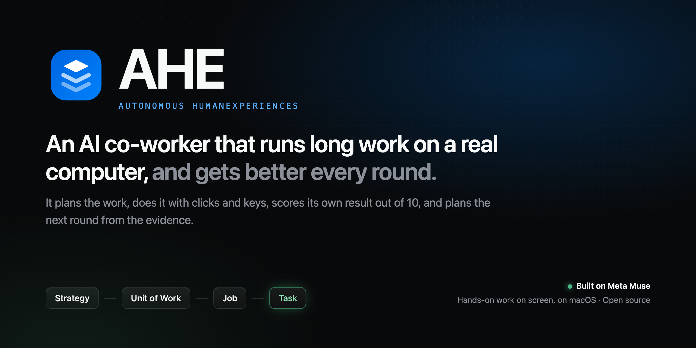
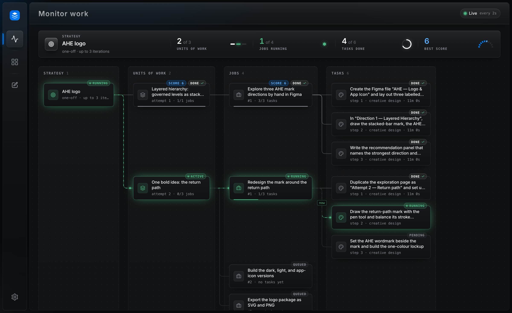
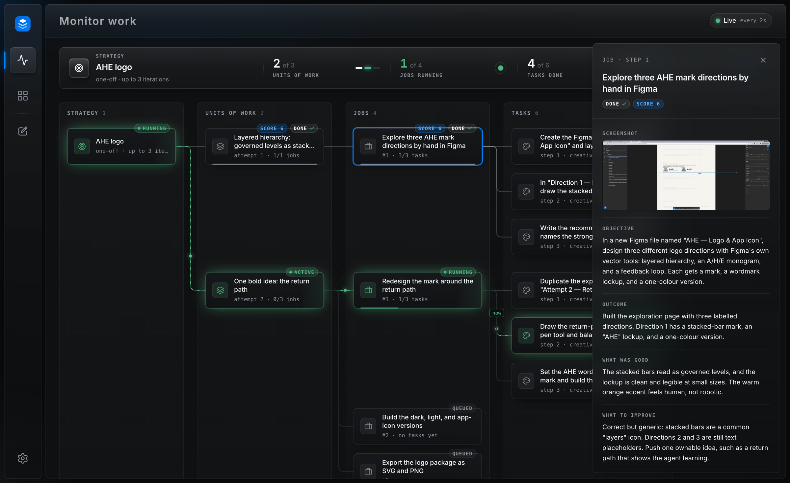
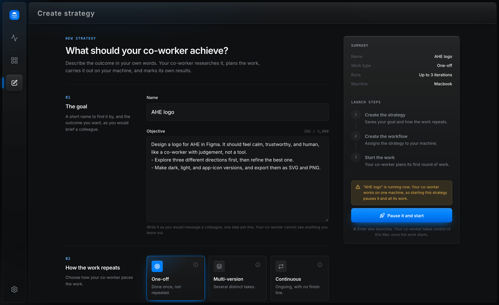
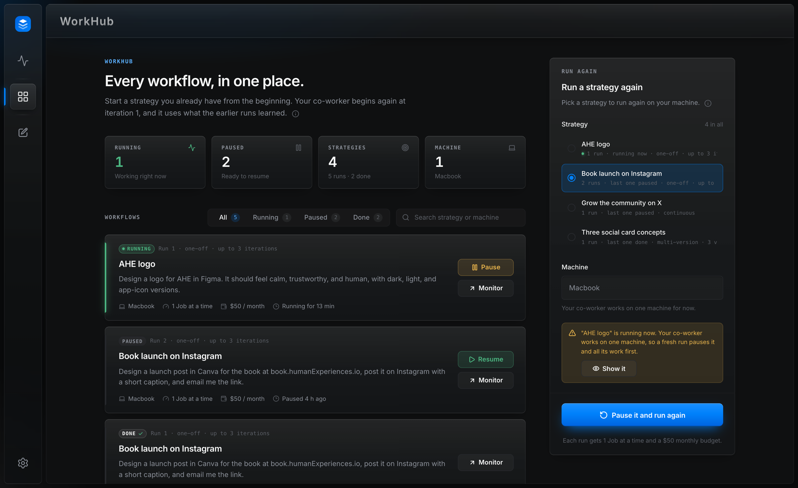
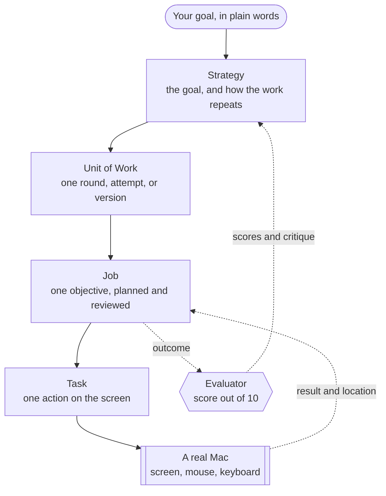

### Give it a goal. It plans, acts on a real computer, and self-improves with every round.


**[Quick start](#quick-start)** · **[How it works](#how-it-works)** · **[The dashboard](#the-dashboard)** · **[Safety](#safety)** · **[Architecture](#architecture)**


  


## What AHE is

Most AI agents stop at advice. Others run one loop with a few tools, and they lose the thread after an hour.
AHE is different. It is an **AI co-worker**. It takes ownership of a goal, and it carries the work for days or weeks.

AHE has its own internal governance and orchestration system. The system breaks a goal into levels of work.
AHE does each piece on a real Mac with the mouse and the keyboard, like a person. Then it scores the result
out of 10, and it plans the next round from that evidence. It recovers from failures, gets past routine
obstacles, and builds a knowledge base of what worked. It asks you only when a decision is yours to make.

You do not prompt it step by step. You brief it once, like a colleague. Then you watch it work.

> [!NOTE]
> We built AHE for the Meta Hackathon. **Meta Muse runs every layer**: the planning, the judgement, and the
> hands-on work on screen. One Meta API key is enough to run all of it.

## A co-worker, not an assistant

An assistant waits for your next prompt. A co-worker owns a piece of the work, and its judgement grows over time.

| | A typical agent | AHE |
| --- | --- | --- |
| Scope | One prompt, one loop | One goal that runs for days or weeks |
| Memory of the work | The chat window | A database of every round, Job, Task, and score |
| Quality | It stops when the steps end | It scores its own work and tries a better idea |
| Evidence | It guesses | It opens the real post, file, or design first |
| When stuck | It fails or loops | It recovers, waits, or asks you one clear question |
| Control | Kill the process | Pause, resume, or run again from a dashboard |

## What it can do

- **Three kinds of work.** *One-off* work, such as a launch post, gets up to 3 attempts until it is good.
*Multi-version* work, such as three logo concepts, makes each version in a new direction. *Continuous*
work, such as a community on X, runs in rounds of experiments with no finish line.
- **Any app on the Mac.** It works in Figma, Canva, and the browser. It sees the screen, then clicks,
types, scrolls, and zooms to read small text.
- **Research first.** Before it plans, it reads the links in your brief and searches the web for every name
in it. It also studies how the best current work of that kind looks.
- **Honest marks.** It scores each Job out of 10 on an anchored scale. It looks at the real screenshot, not a
summary. When it does not know what good looks like, it searches the web for strong examples first.
- **Real evidence.** A post marked one minute after it went live has no likes yet. So AHE sends a real Job back
to the computer to open the post and read the numbers. Then it scores.
- **Learning across rounds and runs.** The next round starts from the last scores and critiques. A fresh run
of the same goal reads the last three runs. Past verdicts are stored as vectors, so AHE finds similar work
by meaning.
- **Recovery on its own.** It closes popups and reloads broken pages. It waits out rate limits. After a crash,
it plans from what is already on the screen, so it never repeats a half-done step blindly.
- **Its own lane.** Each Job and each Task knows which work belongs to later steps, and it leaves that work alone.
- **One clear question when it must.** No login for a site? It parks the Task and asks you. You approve or
reject once, and the work continues.

## The dashboard

The dashboard is where you brief your co-worker and watch it work. It is dark, glassy, and live.

The screenshots below use sample data. The Figma screen inside the Job panel comes from a real AHE run.

### Watch the work, live



The **Monitor** page draws the whole run as a live board in four lanes: Strategy, Units of Work, Jobs, and
Tasks. The green card runs now, and a light flows along its line. The bar on top sums up the run: the rounds,
the Jobs at work, the Tasks done, and the best score. The board updates every 2 seconds.

AHE uses the Mac's own screen, so watch from your phone. `pnpm dev:start` prints the Wi-Fi address and a QR code.

### See what it made, and how it judged it



Click any card to open its details. A Job shows the final screen of its work, the objective, the outcome, and
the agent's own marks: what was good, and what to improve. Click the screenshot to see it full screen.

In this run, AHE gave its first logo a 6. It called the work "correct but generic". Attempt 2 starts from one
bolder idea: a path that returns to its start. The mark shows an agent that measures, learns, and redirects.

### Brief it like a colleague



1. Open **Create strategy**.
2. Write a short name and the outcome you want, one step per line.
3. Choose how the work repeats: one-off, multi-version, or continuous.
4. Click **Launch**. The side panel shows each launch step, and the dashboard opens Monitor.

### Every run in one place



A Strategy is a reusable goal. Each Workflow is one run of it: running, paused, or done. **WorkHub** lists every
run. Pause one, resume it, or open it in Monitor. To start a goal again from round 1, pick it in **Run again**.
The fresh run still learns from the earlier runs. One Mac runs one Workflow at a time, so AHE pauses the
current run first.

## How it works

### Four levels of work



Each level reads only a short summary of the level below it. The Strategy planner never sees a Task. The Task
planner never sees a screenshot. Only the final screen of a visual Task goes up, to the Job reviewer and the
evaluator. This keeps long autonomy cheap, and the thread stays clear after hundreds of steps.

### The loop that makes it better

1. **Plan.** The Strategy planner researches the brief and writes the Jobs of the next round. Each round names

   the idea it tests, and why.
2. **Act.** For each Task, the Task planner writes one step. The hands-on agent does the work on screen and
   reports back. The planner reads the result and writes the next step, until the Task is done.
3. **Review.** The Job reviewer checks every finished Task. It continues, revises the plan, or closes the Job.
4. **Judge.** When a round ends, the evaluator scores each Job out of 10. It writes what was good and what to

   improve, as advice for its own planner.
5. **Learn.** The next round starts from those scores. When the stop rule says the goal is met, the run is done.

The orchestrator moves every run forward once a minute. A pass decides when a round opens, when it is judged,
and which Jobs may start.

### Thinking and doing are separate

The **reasoning layer** plans and judges. It writes structured JSON and never touches the screen. The
**execution layer** sees the screen, and clicks and types. It gets one plain instruction, the scope of its Task,
and nothing else. Each level picks its own model, so a fast model can plan every step and a strong model can
judge.

## Quick start

### What you need

- **A Mac with macOS.** AHE controls this Mac's own screen. Use a Mac that the agent can have while it works.
- **Docker Desktop**, for Postgres and Redis.
- **Node.js 22** and **pnpm 10**. Run `corepack enable` to get pnpm.
- **Xcode Command Line Tools**, for the native mouse and keyboard module. Run `xcode-select --install`.
- **A Meta API key** for Muse. An Anthropic key also works, if you want Claude.

### Run it

1. Clone the repository and install the packages.
   ```bash
    git clone https://github.com/BaraaSoft/ahe-autonomous-agent.git
    cd ahe-autonomous-agent
    corepack enable
    pnpm install
   ```
2. Create your `.env` file from the example.
   ```bash
    cp .env.example .env
   ```
3. Open `.env`. Add your Meta key, and set every layer to Muse.
   ```dotenv
    META_API_KEY=your-meta-api-key

    REASONING_STRATEGY_PROVIDER=muse
    REASONING_JOB_PROVIDER=muse
    REASONING_TASK_PROVIDER=muse
    EXECUTION_PROVIDER=muse
   ```
4. Start the database and the queue. Leave this terminal open.
   ```bash
    pnpm compose:up
   ```

    This starts Postgres with pgvector on port 5433 and Redis on port 6380. Then it applies every migration.
5. In a new terminal, give the agent the screen.
   ```bash
    pnpm --filter @ahe/execution check:desktop
   ```

    macOS asks you to allow your terminal app in **Accessibility** and **Screen Recording**. Allow both, then
    restart the terminal. The check saves one screenshot, and it sends no mouse or keyboard input.
6. Launch AHE.
   ```bash
    pnpm dev:start
   ```

    This starts the backend on port 3088 and the dashboard on port 5173. The first start also downloads a small
    embedding model, one time.
7. Open [http://localhost:5173](http://localhost:5173), and create your first strategy. Start small, for

   example: *"Open Figma, create a file named AHE test, and draw a calm blue circle."*

> [!WARNING]
> AHE uses the real mouse and keyboard. Do not use the Mac while a Task runs. Pause the run from the dashboard
> first, and the agent stops after its current step.

### Choose the models

Each layer reads its own setting in `.env`. Set a provider to `muse` or `anthropic`, and mix them if you like.
The Anthropic provider uses `ANTHROPIC_API_KEY`.

| Setting | What it runs | Muse default |
| --- | --- | --- |
| `REASONING_STRATEGY_PROVIDER` | Plans each round, and judges the work | `muse-wonder-1.0` |
| `REASONING_JOB_PROVIDER` | Plans and reviews the Tasks of each Job | `muse-wonder-1.0` |
| `REASONING_TASK_PROVIDER` | Plans every step, the hot path | `muse-wonder-1.0` |
| `EXECUTION_PROVIDER` | Sees the screen, clicks, and types | `muse-wonder-1.0` |

Each provider has a matching `_MODEL_ID` setting. We suggest `muse-spark-1.3` for the Task planner, because it
is faster. Keep `muse-wonder-1.0` for execution, because Spark often stops early on screen work.

### Useful commands

| Command | What it does |
| --- | --- |
| `pnpm dev:start` | Starts the backend and the dashboard together |
| `pnpm compose:down` | Stops Postgres and Redis |
| `pnpm dev:reset` | Clears every run, queue, and screenshot, and keeps your Strategies. Stop the backend first |
| `pnpm test` | Runs the unit tests of every package |
| `pnpm test:integration` | Runs the database tests against a real Postgres |
| `pnpm typecheck` | Type-checks every package |

The integration tests need an `ahe_test` database. Create it once:

```bash
docker compose -f docker-compose-dev.yml exec postgres createdb -U ahe ahe_test
```

The backend also serves two admin tools: the API docs at [localhost:3088/admin/docs](http://localhost:3088/admin/docs)
and the queues at [localhost:3088/admin/queues](http://localhost:3088/admin/queues). The login comes from
`ADMIN_USERNAME` and `ADMIN_PASSWORD` in `.env`.

## Safety

The safety rules live in the structure, not in a filter at the end.

- **The screen is untrusted.** Only the instruction counts. AHE never follows text it finds on a web page, in a
message, or in a notification.
- **Hard walls.** It never opens Terminal, changes system settings, makes purchases, accepts terms, creates
accounts, or changes passwords.
- **Gates it never passes.** A CAPTCHA, a verification code, or an account warning stops the Task. AHE reports
it, and a planner decides what happens next.
- **Owner escalation.** Some decisions belong to you, such as a login it does not have. AHE parks the Task and  
asks you. (coming soon)
- **Guardrails on effort.** Three failed Tasks in a row close a Job. A Job plans around a budget of 20 Tasks,
and it stops at a hard limit of 60.
- **Credentials stay where they belong.** AHE types a login only on its own site, and never repeats it in a
report. It also removes tokens and tracking codes from every saved link.
- **One machine, one run.** A new run on the Mac pauses the current one first, so two runs never fight for
the mouse.

The bridge to HumanExperiences memory sits behind a **privacy wall** that fails closed. The bridge is not wired
yet, so no private memory reaches the agent today.

## Architecture

```text
packages/
├── agent-core/    shared domain types and contracts
├── backend/       NestJS: the API, the reasoning layer, the BullMQ queues, and the orchestrator
├── execution/     computer use: the macOS driver, and the Claude and Muse providers
├── migrations/    TypeORM migrations, applied by Docker on start
└── web-ui/        the React dashboard
```

**The stack:** TypeScript in strict mode, NestJS 11, PostgreSQL with pgvector, Redis with BullMQ, TypeORM, and
React with Vite, Emotion, and Framer Motion. The execution layer uses robotjs for input, macOS `screencapture`
for pixels, and sharp to scale each screenshot.

**The engineering rules we hold to:**

- **The database is the source of truth.** Queues only carry work. A message that arrives late, twice, or out of
order changes nothing.
- **Every state change checks the state it expects.** A Task delivered twice runs once.
- **Reasoning is stateless.** Each reasoner reads its inputs from the database, decides, and returns JSON.
- **Tests at every level.** 479 automated tests: 277 backend unit tests, 69 database integration tests, and
133 execution tests. An end-to-end suite also runs the real desktop with a real model.

Read the design documents for the details:

| Document | What it explains |
| --- | --- |
| [Orchestrator](packages/backend/src/orchestrator/tech-spec.md) | Runs, work types, the scheduling pass, and when work is judged |
| [Governance processors](packages/backend/src/governance/processors/tech-spec.md) | How Jobs and Tasks move, wait, fail, and recover |
| [Reasoning](packages/backend/src/reasoning/tech-spec.md) | Every planner and the evaluator, their inputs, and their prompts |
| [Execution](packages/execution/tech-spec.md) | The computer-use loop, the macOS driver, and the providers |

## Roadmap

- Connect the HumanExperiences memory, behind the privacy wall.
- Run several Macs at once, one Workflow on each.
- Add more skills, for video editing and long-form writing.
- Let the owner answer questions from the dashboard and from the phone (coming soon)

## License

AHE is open source under the [GNU Affero General Public License v3.0](LICENSE).

  
Built by [Baraa](https://github.com/BaraaSoft) for the Meta Hackathon, 2026.
