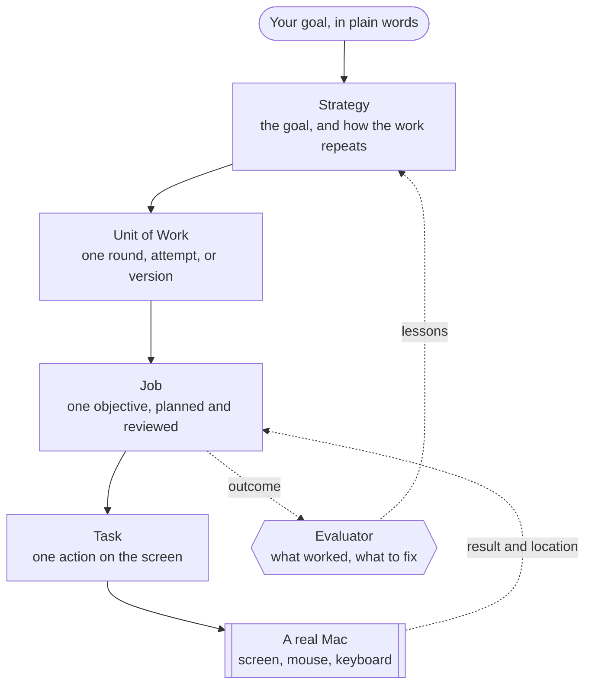

<div align="center">

### Give it a goal. It plans, acts on a real computer, and self-improves with every round.


        


**[Website](https://agentcores.ai)** · **[Demo](#demo)** · **[Quick start](#quick-start)** · **[How it works](#how-it-works)** · **[The dashboard](#the-dashboard)** · **[Safety](#safety)** · **[Project structure](#project-structure)**

<br />


</div>

## What AgentCores.AI is

It is an **AI co-worker**. It takes ownership of a goal, and it carries the work for days or weeks.

AgentCores.AI has its own internal governance and orchestration system. The system breaks a goal into levels of work,
so many AI agents can work as one co-worker and share what they learn. AgentCores.AI does each piece on a real Mac with
the mouse and the keyboard, like a person. It self-improves. It learns from its own work: it keeps what worked,
and it fixes what did not. It recovers from failures, gets past routine obstacles, and builds a knowledge base
as it goes.

You do not prompt it step by step. You brief it once, like a colleague. Then you watch it work.

## Demo

One run, from start to end. AgentCores.AI plans a book launch, designs the graphic in Canva, marks its own work, and posts
it on X. The dashboard is on the left, and the Mac screen is on the right. Both are sped up.

https://github.com/user-attachments/assets/e6935fdd-6f6c-48c8-928a-4fbc207588c5

## A co-worker, not an assistant

An assistant waits for your next prompt. A co-worker owns a piece of the work, and its judgement grows over time.

| | A typical agent | AgentCores.AI |
| --- | --- | --- |
| Scope | One prompt, one loop | One goal that runs for days or weeks |
| Memory of the work | The chat window | A knowledge base of every round, Job, Task, and lesson |
| Quality | It stops when the steps end | It learns from its own work and tries a better idea |
| Evidence | It guesses | It opens the real post, file, or design first |
| When stuck | It fails or loops | It recovers, waits, or asks you one clear question |
| Control | Kill the process | Pause, resume, or run again from a dashboard |

## What it can do

**Governance, not just execution.** AgentCores.AI splits a goal into four levels: Strategy, Unit of Work, Job, and Task.
Each level plans on its own and reads only a short summary of the level below. This keeps long autonomy cheap
and clear, even after hundreds of steps. Many agents work as one co-worker and share what they learn.

**Self-improvement is the core.** After every round, an evaluator reviews each Job against real evidence: the
actual output and the actual numbers, opened on the real screen. When the evidence is missing, AgentCores.AI sends a real
Job to get it, for example to open the analytics dashboard and read this week's sign-ups. The lessons feed the
next round: keep what worked, fix what did not. A new run of the same goal reads the last three runs, and AgentCores.AI
finds similar past work by meaning. In [our benchmark](eval/), it never ranked weak work above strong work.

**Any app on the Mac.** AgentCores.AI operates macOS with the mouse, the keyboard, and screenshots, like a person. It works  
in Canva, spreadsheets, the browser, or anything else on the screen. It recovers on its own from popups, broken pages,  
rate limits, and crashes.

**Safety by design.** Hard walls block system settings, purchases, and account changes. AgentCores.AI reports a CAPTCHA
and never solves it. It types a login only on that login's own site.

## The dashboard

The dashboard is where you brief your co-worker and watch it work. It is dark, glassy, and live.

The screenshots below use sample data. The Canva graphic inside the Job panel is real: AgentCores.AI designed it in an earlier run.

### Watch the work, live


The **Monitor** page draws the whole run as a live board in four lanes: Strategy, Units of Work, Jobs, and
Tasks. The green card runs now, and a light flows along its line. The bar on top sums up the run: the rounds,
the Jobs at work, the Tasks done, and the best result. The board updates every 2 seconds.

AgentCores.AI uses the Mac's own screen, so watch from another laptop or a phone. `npx agentcores up` prints the
Wi-Fi address to open on a device on the same network.

### See what it made, and what it learned


Click any card to open its details. A Job shows the final screen of its work, the objective, the outcome, and  
the agent's own review: what worked, and what to fix. Click the screenshot to see it full screen.

### Brief it like a colleague


1. Open **Create strategy**.
2. Write a short name and the outcome you want, one step per line.
3. Choose how the work repeats: one-off, multi-version, or continuous.
4. Click **Launch**. The side panel shows each launch step, and the dashboard opens Monitor.

### Every run in one place


A Strategy is a reusable goal. Each Workflow is one run of it: running, paused, or done. **WorkHub** lists every
run. Pause one, resume it, or open it in Monitor. To start a goal again from round 1, pick it in **Run again**.
The fresh run still learns from the earlier runs.  
One Mac runs one Workflow at a time, so AgentCores.AI pauses the current run first.

## How it works

### Four levels of work



Each level reads only a short summary of the level below it. The Strategy planner never sees a Task. The Task
planner never sees a screenshot. Only the final screen of a visual Task goes up, to the Job reviewer and the
evaluator. This keeps long autonomy cheap, and the thread stays clear after hundreds of steps.

### The loop that makes it better

1. **Plan.** The Strategy planner researches the brief and writes the Jobs of the next round. Each round names
   the idea it tests, and why.
2. **Act.** For each Task, the Task planner writes one step. The hands-on agent does the work on screen and
   reports back. The planner reads the result and writes the next step, until the Task is done.
3. **Review.** The Job reviewer checks every finished Task. It continues, revises the plan, or closes the Job.
4. **Reflect.** When a round ends, the evaluator reviews each Job. It writes what worked and what to fix, as
   advice for its own planner.
5. **Self-improve.** The next round keeps what worked and fixes what did not. When the stop rule says the goal
   is met, the run is done.

The orchestrator moves every run forward once a minute. A pass decides when a round opens, when it is reviewed,
and which Jobs may start.

### Thinking and doing are separate

The **reasoning layer** plans and reviews. It never touches the screen. The **execution layer** sees the screen,  
and clicks and types. It gets one plain instruction, the scope of its Task, and nothing else.  
Each level picks its own model, so a fast model can plan every step and a strong model can review.

## Quick start

### What you need

- **A Mac with Apple silicon.** AgentCores.AI controls this Mac's own screen. Use a Mac that the agent can have while
  it works.
- **[Docker Desktop](https://www.docker.com/products/docker-desktop)**, running. It holds the database and the queue.
- **[Node.js 22](https://nodejs.org)** or newer.
- **An Anthropic API key**, for Claude. A Meta API key for Muse also works.

### Run it

1. Set it up. This checks Docker, starts the database, and asks for your API key.
   ```bash
    npx agentcores init
   ```
2. Start it. The dashboard opens in your browser at [http://localhost:3088](http://localhost:3088).
   ```bash
    npx agentcores up
   ```
3. Create your first strategy.

The first time, macOS asks you to allow your terminal app in **Accessibility** and **Screen Recording**. Allow
both, quit and reopen the terminal, and run `npx agentcores init` again.

| Command | What it does |
| --- | --- |
| `npx agentcores init` | Checks Docker and the permissions, resets the containers, migrates the database, asks for keys |
| `npx agentcores up` | Starts AgentCores.AI in the background, and opens the dashboard |
| `npx agentcores down` | Stops AgentCores.AI and its database. Your data stays |
| `npx agentcores status` | Shows what runs |
| `npx agentcores logs` | Follows the backend log |

Your settings, data, and logs live in `~/.agentcores`. Edit `~/.agentcores/.env` to change the models.


> [!WARNING]
> AgentCores.AI uses the real mouse and keyboard. Do not use the Mac while a Task runs. Pause the run from the dashboard
> first, and the agent stops after its current step.

### Choose the models

`npx agentcores init` asks which provider to use, and sets it on every layer. To mix them, edit
`~/.agentcores/.env`. Set a provider to `anthropic` or `muse`, then run `npx agentcores down` and
`npx agentcores up`. The Anthropic provider uses `ANTHROPIC_API_KEY`, and Muse uses `META_API_KEY`.

| Setting | What it runs | Suggested model |
| --- | --- | --- |
| `REASONING_STRATEGY_PROVIDER` | Plans each round, and reviews the work | `claude-opus-5-5` |
| `REASONING_JOB_PROVIDER` | Plans and reviews the Tasks of each Job | `claude-opus-5-5` |
| `REASONING_TASK_PROVIDER` | Plans every step, the hot path | `claude-opus-5-5` |
| `EXECUTION_PROVIDER` | Sees the screen, clicks, and types | `claude-sonnet-5-5` |

Each provider has a matching `_MODEL_ID` setting. Leave it empty to use the suggested model. On Muse, every
layer defaults to `muse-wonder-1.0`.

### The queue dashboard

The backend shows its queues at [localhost:3088/admin/queues](http://localhost:3088/admin/queues). The login is
`ADMIN_USERNAME` and `ADMIN_PASSWORD` in `~/.agentcores/.env`. `npx agentcores init` writes a random password there.

## Troubleshooting

<details>
<summary><b>Troubleshooting guide</b>: fixes for common setup errors</summary>

<br/>

#### "AgentCores.AI needs Docker"

1. Install [Docker Desktop](https://www.docker.com/products/docker-desktop).
2. Open it, and wait until it says "Engine running".
3. Run the command again.

#### "AgentCores.AI needs Node.js 22 or newer"

Check your version with `node -v`. Then switch to Node 22 with the tool you already use:

| You use | Switch to Node 22 |
| --- | --- |
| The installer from [nodejs.org](https://nodejs.org) | Install the 22 LTS release |
| Homebrew | `brew install node@22 && brew link --overwrite --force node@22` |
| nvm | `nvm install 22 && nvm alias default 22` |
| fnm | `fnm install 22 && fnm default 22` |
| Volta | `volta install node@22` |

Open a new terminal, and check that `node -v` shows 22 or newer.

#### "macOS has not given your terminal control of this Mac"

macOS gives these permissions to the app that runs the terminal, not to the terminal tab. In the Cursor or
VS Code terminal, that app is Cursor or VS Code. Otherwise it is Terminal or iTerm.

1. Open **System Settings › Privacy & Security**.
2. Turn the app on in **Accessibility** and in **Screen & System Audio Recording**. If it is not in the list,
   add it with **+**.
3. Quit the app with Cmd+Q, and open it again. A new tab is not enough.
4. Run `npx agentcores init` again.

#### "A port that AgentCores.AI needs is in use"

AgentCores.AI uses port 3088 for the dashboard, 5434 for Postgres, and 6381 for Redis. The message shows a
command that finds the program on the port. Stop that program, then run the command again.

#### The backend stops while it starts

Run `npx agentcores logs` to see the reason. A missing or wrong API key is the most common one. Fix it in
`~/.agentcores/.env`, then run `npx agentcores up` again.

</details>

## Safety

The safety rules live in the structure, not in a filter at the end.

- **The screen is untrusted.** Only the instruction counts. AgentCores.AI never follows text it finds on a web page, in a
message, or in a notification.
- **Hard walls.** It never opens Terminal, changes system settings, makes purchases, accepts terms, creates
accounts, or changes passwords.
- **Gates it never passes.** A CAPTCHA, a verification code, or an account warning stops the Task. AgentCores.AI reports
it, and a planner decides what happens next.
- **Owner escalation.** Some decisions belong to you, such as a login it does not have. AgentCores.AI parks the Task and  
asks you. (coming soon)
- **Guardrails on effort.** Three failed Tasks in a row close a Job. A Job plans around a budget of 20 Tasks,
and it stops at a hard limit of 60.
- **Credentials stay where they belong.** AgentCores.AI types a login only on its own site, and never repeats it in a
report. It also removes tokens and tracking codes from every saved link.
- **One machine, one run.** A new run on the Mac pauses the current one first, so two runs never fight for
the mouse.

## Project structure

```text
packages/
├── agent-core/    shared domain types and contracts
├── cli/           the `npx agentcores` command, published to npm as `agentcores`
├── backend/       runs on your Mac (localhost:3088): the API, the reasoning layer, the queues, and the orchestrator
├── execution/     the hands-on agent: the macOS driver, and the Muse and Claude providers
├── migrations/    migrations, applied by `npx agentcores init` and `up`
└── web-ui/        the dashboard, which the backend serves on localhost:3088
```

<details>
<summary><b>Engineering notes</b>: the rules we hold to</summary>

<br/>


- **The database is the source of truth.** Queues only carry work. A message that arrives late, twice, or out of
order changes nothing.
- **Every state change checks the state it expects.** A Task delivered twice runs once.
- **Reasoning is stateless.** Each reasoner reads its inputs from the database, decides, and returns JSON.
- **Tests at every level.** 479 automated tests: 277 backend unit tests, 69 database integration tests, and
133 execution tests. An end-to-end suite also runs the real desktop with a real model.
- **A benchmark for the self-review.** [`eval/`](eval/) runs the real evaluator on pairs of strong and weak
work, on screenshots of real visual work, and on Jobs that need live evidence. It reports ranking accuracy, evidence requests, valid output,
and latency.

</details>


## License

AgentCores.AI is open source under the [GNU Affero General Public License v3.0](LICENSE).

Follow [@baraaabuzaid](https://x.com/baraaabuzaid) on X for updates on AgentCores.AI.
