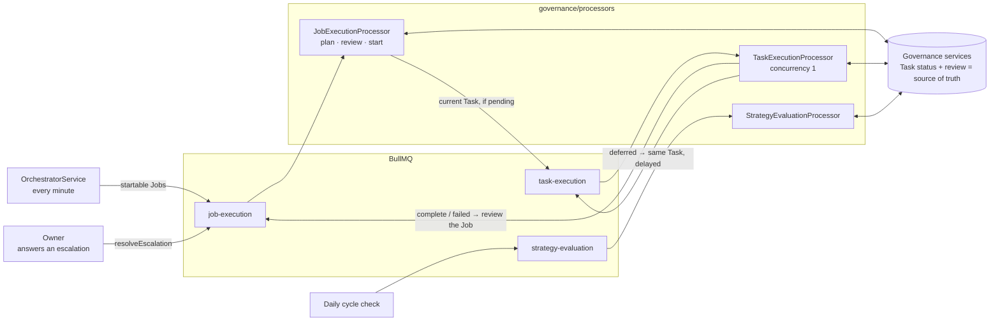
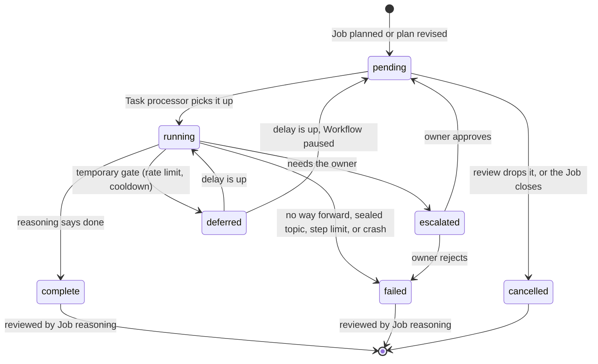
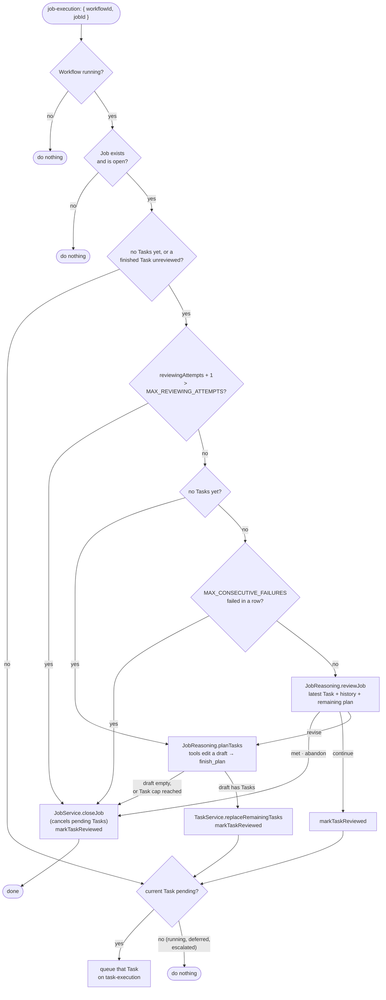
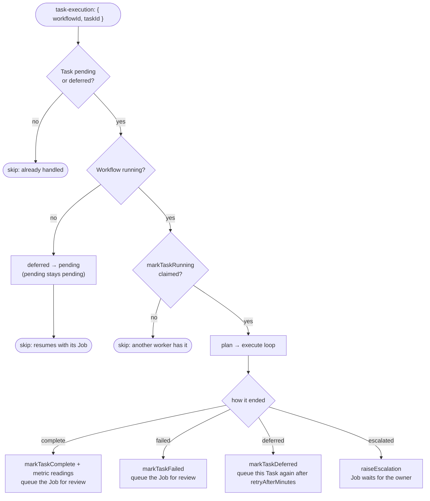

# Governance processors

The BullMQ workers that move work through governance: the **Job processor** plans a Job, reviews every
Task it finishes, and starts the next one; the **Task processor** runs one Task at a time on screen; and
the **Strategy evaluation processor** reviews a cycle when its 30 days are up. This document explains how
Jobs and Tasks move: who queues what, when a Job may go on, when it must wait, and how it ends.

- [Where they sit](#where-they-sit)
- [The processors](#the-processors)
- [The rule: a Job is its current Task](#the-rule-a-job-is-its-current-task)
- [Task lifecycle](#task-lifecycle)
- [How a Job ends](#how-a-job-ends)
- [Job processor](#job-processor)
- [Task processor](#task-processor)
- [Who queues what](#who-queues-what)
- [Scenarios](#scenarios)
- [Guarantees](#guarantees)
- [Open points](#open-points)
- [Folder layout](#folder-layout)

Related: the Task loop step by step in [docs/tech-spec.md §5.4](../../../../../docs/tech-spec.md), and
the reasoners these processors call in [reasoning/tech-spec.md](../../reasoning/tech-spec.md).

---

## Where they sit



The queues only carry work; they hold no rules. **Whether a Job may move on is decided by its Tasks in
the database** — their status and whether Job reasoning has reviewed them — so the queue can deliver late,
twice, or out of order without breaking it.

---

## The processors

| Processor | Queue | Payload | Concurrency | Queue retries | Calls |
| --- | --- | --- | --- | --- | --- |
| `JobExecutionProcessor` | `job-execution` | `{ workflowId, jobId }` | default | 3, exponential backoff | `JobReasoningService.reviewJob` (after every finished Task), `planTasks` (first plan, and when the review asks) |
| `TaskExecutionProcessor` | `task-execution` | `{ workflowId, taskId }` | **1** — one screen, one mouse | **none** — a crashed Task may already have posted | `TaskReasoningService`, `ExecutionProvider` |
| `StrategyEvaluationProcessor` | `strategy-evaluation` | `{ workflowId }` | default | 3, exponential backoff | `StrategyEvaluationService` |

The Job queue uses the Job's ID as the queue job ID and removes entries on completion, so a Job already
waiting is never queued twice, and the same Job can be queued again later.

---

## The rule: a Job is its current Task

A Job is **open** until it is closed with an outcome (`success`, `abandoned`, `failed` — see
[How a Job ends](#how-a-job-ends)). While open it has no status column: its **current Task** — the
lowest-sequence Task that is not finished (`complete`, `failed`, or `cancelled`) — decides what state the
Job is in. One more condition comes first: a finished Task that Job reasoning has not reviewed yet
(`reviewedAt` is null) holds the Job until it is reviewed.

| Job's Tasks | Job state | What happens |
| --- | --- | --- |
| *(no Tasks yet)* | new | The Job processor writes the first plan |
| a `complete` / `failed` Task not reviewed | needs review | The Job processor reviews it, and replans if the review asks |
| current Task `pending` | ready | Queue the current Task |
| current Task `running` | running | Wait |
| current Task `deferred` | deferred | Wait for the delayed queue item |
| current Task `escalated` | escalated | Wait for the owner |
| Job has an outcome | closed | Nothing; its pending Tasks were cancelled |

Because only the current Task is ever looked at, and only after the last result is reviewed, **a Job can
never skip past a stuck Task or run ahead of its plan**, and any new Task status holds the Job by default.
The rule lives in the services:

- `TaskService.findUnreviewedTask(jobId)` returns the finished Task awaiting review, if any.
- `TaskService.findNextPendingTask(jobId)` returns the current Task when it is `pending` and nothing awaits
  review, otherwise null.
- `JobService.listStartableJobs` returns open Jobs that are new, need review, or are ready.

Example — a Job whose plan was revised after Task 2 failed:

| Sequence | Action | Status | Reviewed |
| --- | --- | --- | --- |
| 1 | Open r/AICompanion | `complete` | ✓ |
| 2 | Post the launch link | `failed` (links not allowed) | ✓ |
| 3 | Reply to the top thread | `cancelled` (dropped by the review) | — |
| 4 | Post a text-only intro | **`pending`** ← current Task, so the Job is ready | — |
| 5 | Reply to the top thread | `pending` | — |

The review cancelled the old remaining plan (Task 3) and appended the new one (Tasks 4–5). Sequences only
grow, so the history of what was planned and dropped stays readable.

---

## Task lifecycle



| Transition | Done by | Method |
| --- | --- | --- |
| → `pending` (created) | Job processor | `TaskService.replaceRemainingTasks` |
| `pending` → `cancelled` | Job processor | `replaceRemainingTasks` (plan changed) or `JobService.closeJob` |
| `pending` / `deferred` → `running` | Task processor | `markTaskRunning` |
| `running` → `complete` | Task processor | `markTaskComplete` |
| `running` → `failed` | Task processor | `markTaskFailed` (also from `escalated`, when the owner rejects) |
| `running` → `escalated` | Task processor, through reporting | `ReportingService.raiseEscalation` → `markTaskEscalated` |
| `running` → `deferred` | Task processor | `markTaskDeferred` (+ delayed queue item) |
| `deferred` → `pending` | Task processor, when the delay ends while paused | `markTaskPending` |
| `escalated` → `pending` / `failed` | Owner | `ReportingService.resolveEscalation` |
| `complete` / `failed` → reviewed | Job processor | `markTaskReviewed` |

**Failed no longer holds a Job.** A failed Task is a result like any other: Job reasoning reviews it and
decides whether to retry it differently, route around it, or stop.

**Deferred and escalated are different waits.** A deferred Task waits for *time* and comes back on its
own. An escalated Task waits for *the owner*: nothing changes until they answer, so it is never retried
on a timer — that would repeat the same request and could repeat the step that needed a human.

---

## How a Job ends

A Job closes once, through `JobService.closeJob`, which records `outcomeStatus`, `outcomeSummary`, and
`closedAt` and cancels the Tasks that had not started. Who decides depends on the outcome:

| Outcome | Meaning | Decided by | When |
| --- | --- | --- | --- |
| `success` | The objective was met | Job reasoning | The review's decision is `met` |
| `abandoned` | **We decided to stop** — a strategic signal | Job reasoning | The review's decision is `abandon` |
| `failed` | **We couldn't do it** — an execution signal | The system | `MAX_CONSECUTIVE_FAILURES` failed Tasks in a row, the plan is empty, `MAX_TASKS_PER_JOB` reached, or Job reasoning itself kept throwing (`MAX_REVIEWING_ATTEMPTS`) |

Job reasoning never chooses `failed`; it can only stop by abandoning, and the prompt tells it not to
abandon because Tasks keep failing. The Unit and Strategy reviews read the two differently: many
abandoned Jobs argue against the Unit itself (wrong place, wrong audience), while failed Jobs argue for
different Jobs or approaches inside the Unit.

Guardrails on every plan (`job-execution.constants.ts`):

| Constant | Value | Effect |
| --- | --- | --- |
| `MAX_TASKS_PER_JOB` | 20 | Started + planned Tasks never exceed it; reaching it without success closes the Job as failed |
| `MAX_TASKS_ADDED_PER_REVIEW` | 5 | A replan after a review may grow the remaining plan by at most this many Tasks; the planning tools refuse more |
| `MAX_CONSECUTIVE_FAILURES` | 3 | That many failed Tasks in a row close the Job as failed, whatever the plan says |
| `MAX_REVIEWING_ATTEMPTS` | 6 | Job reasoning attempts in a row (queue retries included) that may throw; the next attempt closes the Job as failed without calling reasoning |

`Job.reviewingAttempts` is incremented atomically before every Job reasoning call and reset once the plan
is applied. Without it, a Job whose plan or review keeps throwing would stay startable — it has no Tasks,
or an unreviewed one — and the orchestrator would pay for a reasoning call every pass, forever.

---

## Job processor

Runs when a Job is queued: by the orchestrator, by the Task processor after a Task completes or fails, after
a resume, or after an escalation is resolved.



- **Review, then plan only if needed.** Every finished Task gets one `reviewJob` call (`continue`,
  `revise`, `met`, `abandon`). Most reviews say `continue` and cost nothing more. Job reasoning sees each
  Task's action, status, and compressed result or failure reason — never its steps.
- **Planning edits a draft.** `JobPlanningToolset` (`tools/`) gives the model `view_plan`, `add_task`,
  `update_task`, `remove_task`, `move_task`, and `finish_plan` over an in-memory copy of the remaining
  plan. The tools enforce the Task limit; a bad call returns an error the model can fix. Once planning
  ends, the draft replaces every Task not started yet in one write: an identical draft writes nothing;
  otherwise the pending Tasks are cancelled and the draft is appended. A crash mid-planning saves nothing.
- **The review is stamped last.** `markTaskReviewed` runs after the plan or closure is saved; if the
  processor crashes in between, the next delivery reviews the same Task again, and an unchanged plan
  writes nothing.
- It queues **at most one Task**. The next one is queued only after that Task finishes and is reviewed.

---

## Task processor

Runs one queued Task through the plan → execute loop (the loop itself is in
[docs/tech-spec.md §5.4](../../../../../docs/tech-spec.md)). This chart shows the guard before the loop and
how each ending moves the Job.



- The Task processor never picks the next Task; it hands the Job back to Job reasoning.
- Learnings from blockers go to memory whatever the ending.
- An exception inside the loop marks the Task `failed`, queues the Job for review, and rethrows; with no
  queue retries, the Task is not run again automatically.

---

## Who queues what

| Event | Who queues | What | Queue |
| --- | --- | --- | --- |
| Scheduling pass (every minute) | `OrchestratorService` | Each startable Job, within `maxConcurrentJobs` and budget | `job-execution` |
| A Job is processed | `JobExecutionProcessor` | Its current Task, if pending | `task-execution` |
| A Task completes or fails | `TaskExecutionProcessor` | The Task's Job, for review | `job-execution` |
| A Task is deferred | `TaskExecutionProcessor` | The same Task, delayed by `retryAfterMinutes` | `task-execution` |
| The owner resolves an escalation | `ReportingService.resolveEscalation` | The Task's Job (approved: resume; rejected: review the failure) | `job-execution` |
| A Workflow resumes | `OrchestratorService` (next pass) | Its startable Jobs again | `job-execution` |

The orchestrator never queues Tasks, and nothing queues a Task that is not its Job's current Task. If the
review hand-off is lost, the orchestrator's next pass finds the Job (a finished Task awaits review, so it
is startable) and queues it.

---

## Scenarios

**Happy path.** The orchestrator queues the Job → Job reasoning plans Tasks 1–4 → Task 1 is queued → it
completes and sends the Job back → the review keeps the plan, Task 2 is queued → … → after Task 3 the
review sees the objective is met → the Job closes as `success` and Task 4 is cancelled.

**The world changed.** Task 2 finds the subreddit forbids links → the review says `revise` ("post text
only") → planning removes "post the link", adds "post a text-only intro", and finishes → the Job continues
with the new plan.

**Task failed.** Task 2 fails → the review retries it differently. If three Tasks fail in a row, the Job
closes as `failed` without asking reasoning.

**Not worth it.** After a few Tasks, the community turns out to be inactive → the review says `abandon`
→ the Job closes as `abandoned`, and the Unit review reads it as a signal about the place,
not about execution.

**Rate limit.** Task 2 is blocked; reasoning says "retry in 30 minutes" → Task 2 is `deferred` and
queued again with a 30-minute delay. The orchestrator's passes skip the Job meanwhile, because its current
Task is not pending. After 30 minutes Task 2 runs again from `deferred`. Deferral is not a finished
state, so there is no review.

**Needs the owner.** Task 2 needs a judgment call → it is `escalated` and the Job waits for as long as it
takes. If the owner approves, Task 2 goes back to `pending` and the Job is queued again, which queues
Task 2. If they reject, Task 2 is `failed` and the Job is queued for review, so Job reasoning plans around it.

**Pause and resume.** On pause, queued Tasks are skipped and stay pending; a deferred Task whose delay
ends during the pause goes back to pending; a Job queued for review does nothing and keeps its unreviewed
Task. A Task already running finishes. On resume, the orchestrator queues the Workflow's startable Jobs,
and each is reviewed or picks up at its current Task.

**Duplicate delivery.** A Task delivered twice runs once: the second delivery sees it is no longer
pending or deferred and skips. A Job queued twice reviews its finished Task once (the second delivery
finds nothing unreviewed) and queues the same current Task.

---

## Guarantees

- **In order, per Job.** At most one Task of a Job is running or queued at a time, never one past the
  current Task, and never before the previous result is reviewed.
- **One Task on screen.** The Task processor runs with concurrency 1 across all Workflows.
- **Never twice.** Tasks have no queue retries, and a Task runs only from `pending` or `deferred`.
  `markTaskRunning` is a claim: it changes the status only if the Task is still pending or deferred,
  and returns false otherwise, so two workers can never both run the same Task. Every other
  `markTask*` method is guarded the same way, so a late or duplicate caller changes nothing.
- **Closed once.** `closeJob` only changes an open Job, so a duplicate review cannot change an outcome.
- **Bounded.** A Job never starts more than `MAX_TASKS_PER_JOB` Tasks, one review never adds more than
  `MAX_TASKS_ADDED_PER_REVIEW`, and each finished Task is reviewed once (`reviewedAt`). A plan or review that
  keeps throwing stops after `MAX_REVIEWING_ATTEMPTS`, so no Job loops on Job reasoning.
- **Safe to re-queue.** Queuing a Job again is always safe; it is how reviews, resume, and resolved
  escalations work.
- **The database decides.** Queue items are hints to look at a Job or Task; the statuses decide.

---

## Open points

- **A crash mid-Task leaves it `running`,** which holds its Job forever. A sweep on boot should move
  Tasks stuck in `running` to `failed` (not back to pending, since the step may already have happened);
  the review then handles it like any failure.
- **Escalations have no time limit.** An unanswered escalation holds its Job; a cut-off could fail it
  after a few days.
- **Capacity counts waiting Jobs.** A Job whose current Task is running, deferred, or escalated counts
  toward `maxConcurrentJobs`, so many waiting Jobs can use up the limit.
- **The owner's note is not passed to the Task yet.** When an approval comes with a note, reasoning
  should see it when the Task runs again.
- **Open Jobs at cycle end.** Jobs still open when the Strategy ends are judged by `evaluateJob`; whether
  they are closed or carried into the next Strategy is not decided yet.
- **Units have no processor.** A new Strategy plans every Unit's Jobs up front; planning more Jobs
  mid-cycle is left for later.

---

## Folder layout

```text
governance/processors/
├── tech-spec.md                              ← this file
├── strategy-evaluation.processor.ts          ← end-of-cycle review
├── job-execution/
│   ├── job-execution.module.ts
│   ├── job-execution.processor.ts            ← reviews each finished Task, plans when needed, closes the Job; queues its current Task
│   ├── job-execution.constants.ts            ← context size + plan guardrails
│   ├── tools/job-planning-toolset.ts         ← the plan tools over an in-memory draft (+ tests/)
│   └── tests/job-execution.processor.spec.ts
└── task-execution/
    ├── task-execution.module.ts              ← binds EXECUTION_PROVIDER → @ahe/execution
    ├── task-execution.processor.ts           ← the Task loop; concurrency 1; hands the Job back for review
    ├── task-execution.tokens.ts · task-execution.constants.ts
    ├── types/task-run-outcome.ts
    └── tests/task-execution.processor.spec.ts
```

Each level that runs work has its own folder and Nest module. `TaskExecutionModule` stays separate from
`GovernanceModule` because it needs `ReportingModule`, which imports `GovernanceModule`.
