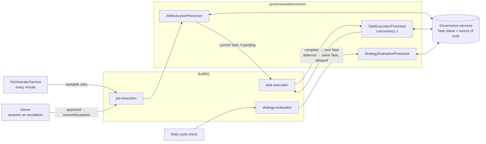
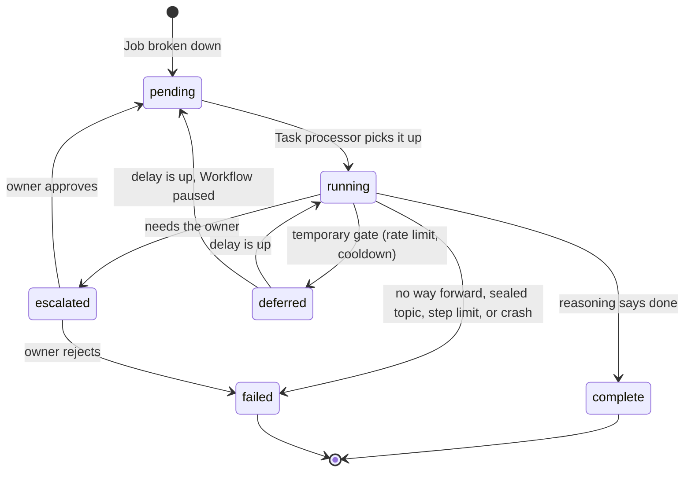
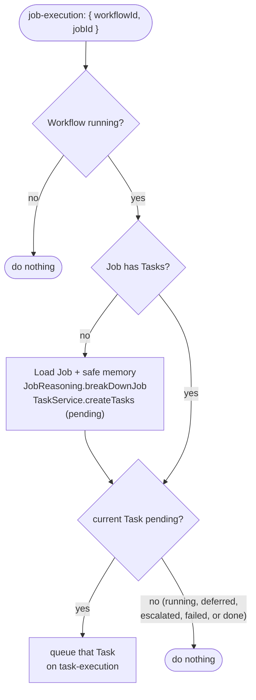
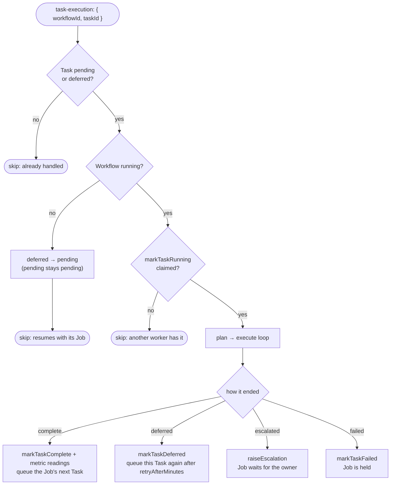

# Governance processors

The BullMQ workers that move work through governance: the **Job processor** turns a Job into Tasks and
starts them, the **Task processor** runs one Task at a time on screen, and the **Strategy evaluation
processor** reviews a cycle when its 30 days are up. This document explains how Jobs and Tasks move:
who queues what, when a Job may go on, and when it must wait.

- [Where they sit](#where-they-sit)
- [The processors](#the-processors)
- [The rule: a Job is its current Task](#the-rule-a-job-is-its-current-task)
- [Task lifecycle](#task-lifecycle)
- [Job processor](#job-processor)
- [Task processor](#task-processor)
- [Who queues what](#who-queues-what)
- [Scenarios](#scenarios)
- [Guarantees](#guarantees)
- [Open points](#open-points)
- [Folder layout](#folder-layout)

Related: the Task loop step by step in [docs/tech-spec.md §5.4](../../../../../docs/tech-spec.md), and
the reasoners these processors call in [reasoning/tech-spec.md](../../reasoning/tech-spec.md).

---

## Where they sit



The queues only carry work; they hold no rules. **Whether a Job may move on is decided by the status of
its Tasks in the database**, so the queue can deliver late, twice, or out of order without breaking it.

---

## The processors

| Processor | Queue | Payload | Concurrency | Queue retries | Calls |
| --- | --- | --- | --- | --- | --- |
| `JobExecutionProcessor` | `job-execution` | `{ workflowId, jobId }` | default | 3, exponential backoff | `JobReasoningService.breakDownJob` (once per Job) |
| `TaskExecutionProcessor` | `task-execution` | `{ workflowId, taskId }` | **1** — one screen, one mouse | **none** — a crashed Task may already have posted | `TaskReasoningService`, `ExecutionProvider` |
| `StrategyEvaluationProcessor` | `strategy-evaluation` | `{ workflowId }` | default | 3, exponential backoff | `StrategyEvaluationService` |

The Job queue uses the Job's ID as the queue job ID and removes entries on completion, so a Job already
waiting is never queued twice, and the same Job can be queued again later.

---

## The rule: a Job is its current Task

A Job has no status column. Its **current Task** — the lowest-sequence Task that is not `complete` —
decides what state the Job is in and what may happen next.

| Current Task | Job state | What happens |
| --- | --- | --- |
| *(no Tasks yet)* | new | The Job processor breaks it down |
| `pending` | ready | Queue the current Task |
| `running` | running | Wait |
| `deferred` | deferred | Wait for the delayed queue item |
| `escalated` | escalated | Wait for the owner |
| `failed` | failed | Held until someone decides what to do |
| *(all complete)* | done | Nothing left to queue |

Because only the current Task is ever looked at, **a Job can never skip past a stuck Task**, and any
new Task status holds the Job by default. Two service methods apply the rule:

- `TaskService.findNextPendingTask(jobId)` returns the current Task when it is `pending`, otherwise null.
- `JobService.listStartableJobs` returns Jobs that are new or ready.

Example — a Job with four Tasks, where Task 2 hit a rate limit:

| Sequence | Action | Status |
| --- | --- | --- |
| 1 | Open r/AICompanion | `complete` |
| 2 | Reply to the top thread | **`deferred`** ← current Task, so the Job is deferred |
| 3 | Upvote two replies | `pending` (not queued) |
| 4 | Check notifications | `pending` (not queued) |

Tasks 3 and 4 are pending but untouched: re-queuing the Job does nothing until Task 2 completes.

---

## Task lifecycle



| Transition | Done by | Method |
| --- | --- | --- |
| → `pending` (created) | Job processor | `TaskService.createTasks` |
| `pending` / `deferred` → `running` | Task processor | `markTaskRunning` |
| `running` → `complete` | Task processor | `markTaskComplete` |
| `running` → `failed` | Task processor | `markTaskFailed` (also from `escalated`, when the owner rejects) |
| `running` → `escalated` | Task processor, through reporting | `ReportingService.raiseEscalation` → `markTaskEscalated` |
| `running` → `deferred` | Task processor | `markTaskDeferred` (+ delayed queue item) |
| `deferred` → `pending` | Task processor, when the delay ends while paused | `markTaskPending` |
| `escalated` → `pending` / `failed` | Owner | `ReportingService.resolveEscalation` |

**Deferred and escalated are different waits.** A deferred Task waits for *time* and comes back on its
own. An escalated Task waits for *the owner*: nothing changes until they answer, so it is never retried
on a timer — that would repeat the same request and could repeat the step that needed a human.

---

## Job processor

Runs when a Job is queued: by the orchestrator, after a resume, or after an approved escalation.



- The breakdown runs **once per Job**: queuing a Job again never re-plans it.
- It queues **at most one Task**. Later Tasks are queued by the Task processor as each one completes.

---

## Task processor

Runs one queued Task through the plan → execute loop (the loop itself is in
[docs/tech-spec.md §5.4](../../../../../docs/tech-spec.md)). This chart shows the guard before the loop and
how each ending moves the Job.



- Learnings from blockers go to memory whatever the ending.
- An exception inside the loop marks the Task `failed` and rethrows; with no queue retries, it is not
  run again automatically.

---

## Who queues what

| Event | Who queues | What | Queue |
| --- | --- | --- | --- |
| Scheduling pass (every minute) | `OrchestratorService` | Each startable Job, within `maxConcurrentJobs` and budget | `job-execution` |
| A Job is processed | `JobExecutionProcessor` | Its current Task, if pending | `task-execution` |
| A Task completes | `TaskExecutionProcessor` | The Job's next Task, if pending | `task-execution` |
| A Task is deferred | `TaskExecutionProcessor` | The same Task, delayed by `retryAfterMinutes` | `task-execution` |
| The owner approves an escalation | `ReportingService.resolveEscalation` | The Task's Job | `job-execution` |
| A Workflow resumes | `OrchestratorService` (next pass) | Its startable Jobs again | `job-execution` |

The orchestrator never queues Tasks, and nothing queues a Task that is not its Job's current Task.

---

## Scenarios

**Happy path.** The orchestrator queues the Job → it is broken into Tasks 1–4 → Task 1 is queued →
it completes and queues Task 2 → … → Task 4 completes, nothing is left, and the Job is done.

**Rate limit.** Task 2 is blocked; reasoning says "retry in 30 minutes" → Task 2 is `deferred` and
queued again with a 30-minute delay. The orchestrator's passes skip the Job meanwhile, because its current
Task is not pending. After 30 minutes Task 2 runs again from `deferred`.

**Needs the owner.** Task 2 needs a judgment call → it is `escalated` and the Job waits for as long as it
takes. If the owner approves, Task 2 goes back to `pending` and the Job is queued again, which queues
Task 2. If they reject, Task 2 is `failed` and the Job stays held.

**Pause and resume.** On pause, queued Tasks are skipped and stay pending; a deferred Task whose delay
ends during the pause goes back to pending. A Task already running finishes. On resume, the
orchestrator queues the Workflow's startable Jobs, and each picks up at its current Task.

**Duplicate delivery.** A Task delivered twice runs once: the second delivery sees it is no longer
pending or deferred and skips. A Job queued twice is broken down once and queues the same current Task.

---

## Guarantees

- **In order, per Job.** At most one Task of a Job is running or queued at a time, and never one past
  the current Task.
- **One Task on screen.** The Task processor runs with concurrency 1 across all Workflows.
- **Never twice.** Tasks have no queue retries, and a Task runs only from `pending` or `deferred`.
  `markTaskRunning` is a claim: it changes the status only if the Task is still pending or deferred,
  and returns false otherwise, so two workers can never both run the same Task. Every other
  `markTask*` method is guarded the same way, so a late or duplicate caller changes nothing.
- **Safe to re-queue.** Queuing a Job again is always safe; it is how resume and approved escalations work.
- **The database decides.** Queue items are hints to look at a Job or Task; the statuses decide.

---

## Open points

- **A failed Job has no way forward yet.** It stays held. Options: let the owner retry or skip the
  Task, or let the review mark the Job abandoned.
- **A crash mid-Task leaves it `running`,** which holds its Job forever. A sweep on boot should move
  Tasks stuck in `running` to `failed` (not back to pending, since the step may already have happened).
- **Escalations have no time limit.** An unanswered escalation holds its Job; a cut-off could fail it
  after a few days.
- **Capacity counts waiting Jobs.** A Job whose current Task is running, deferred, or escalated counts
  toward `maxConcurrentJobs`, so many waiting Jobs can use up the limit.
- **The owner's note is not passed to the Task yet.** When an approval comes with a note, reasoning
  should see it when the Task runs again.
- **Units have no processor.** A new Strategy plans every Unit's Jobs up front; planning more Jobs
  mid-cycle is left for later.

---

## Folder layout

```text
governance/processors/
├── tech-spec.md                              ← this file
├── strategy-evaluation.processor.ts          ← end-of-cycle review
├── job-execution/
│   ├── job-execution.module.ts
│   ├── job-execution.processor.ts            ← breaks a Job down once; queues its current Task
│   ├── job-execution.constants.ts
│   └── tests/job-execution.processor.spec.ts
└── task-execution/
    ├── task-execution.module.ts              ← binds EXECUTION_PROVIDER → @ahe/execution
    ├── task-execution.processor.ts           ← the Task loop; concurrency 1
    ├── task-execution.tokens.ts · task-execution.constants.ts
    ├── types/task-run-outcome.ts
    └── tests/task-execution.processor.spec.ts
```

Each level that runs work has its own folder and Nest module. `TaskExecutionModule` stays separate from
`GovernanceModule` because it needs `ReportingModule`, which imports `GovernanceModule`.
