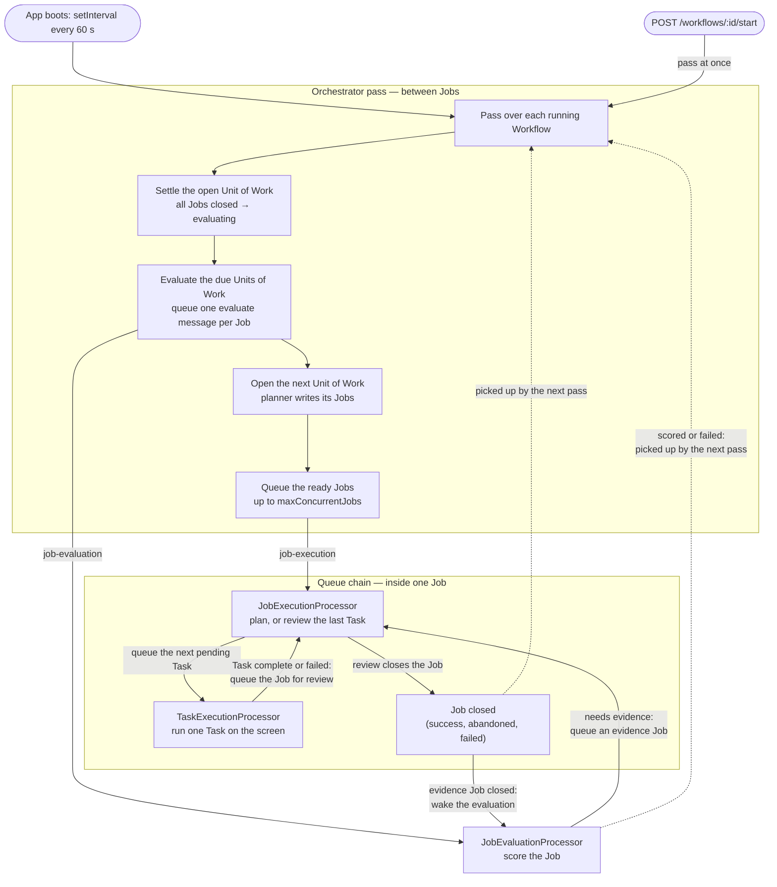
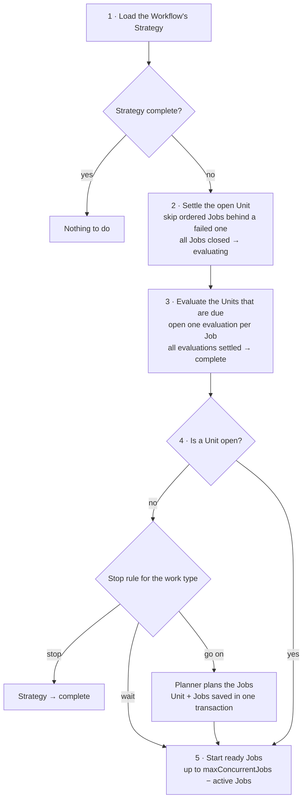
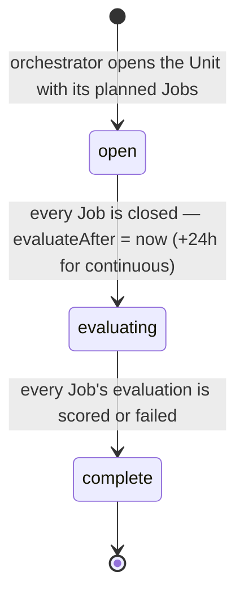

# Orchestrator

The orchestrator is the control plane of the AHE runtime. Every minute it looks at each running Workflow,
moves the Workflow's Strategy forward one step, and starts the Jobs that are ready. It is the only place
that **creates Units of Work** and the only place that **decides when an evaluation starts**. It never
queues Tasks: a queued Job queues its own Tasks, one at a time (see
[governance/processors/tech-spec.md](../governance/processors/tech-spec.md)).

- [The model](#the-model)
- [Work types](#work-types)
- [How the work keeps moving](#how-the-work-keeps-moving)
- [The scheduling pass](#the-scheduling-pass)
- [Unit of Work status](#unit-of-work-status)
- [Job order](#job-order)
- [When work is evaluated](#when-work-is-evaluated)
- [Planning a Unit](#planning-a-unit)
- [Guarantees](#guarantees)
- [Out of scope for now](#out-of-scope-for-now)
- [Folder layout](#folder-layout)

---

## The model

```text
Strategy        what the owner wants, and how the work repeats (its work type)
 └ Unit of Work one round, attempt, or version of that work — a group of Jobs, nothing more
    └ Job       one objective, planned and reviewed by Job reasoning
       └ Task   one action on the screen
```

A **Workflow** is one machine's run of a Strategy. The Workflow holds the resource envelope
(`maxConcurrentJobs`) and the `running` / `paused` switch; the work itself belongs to the Strategy.

A **Unit of Work only groups Jobs.** Nothing reasons about a Unit: it has no success criteria and no
share of effort. The orchestrator creates one when the Strategy has no open Unit, the planner fills it
with Jobs, and it is evaluated as a whole once all its Jobs are closed. The next Unit learns from those
evaluations.

---

## Work types

The owner picks the work type when they create the Strategy. The planner never changes it.

| Work type | Each Unit is | The next Unit opens | The Strategy completes |
| --- | --- | --- | --- |
| `continuous` | a round of experiments ("Round 3") | as soon as no Unit is open — it does not wait for the last round's evaluation | never |
| `one_off` | an attempt at the outcome ("Attempt 2") | after the last attempt is evaluated, if the planner says the outcome is not met yet | when the planner says the outcome is met, or after `maxAttempts` attempts (default 3) |
| `multi_version` | one version of the outcome ("Version 2") | after the last version is evaluated | after `versionCount` versions |

- **`continuous`** is the co-worker: it tries something, checks what landed, and tries again, for as long
  as the owner lets it run. Its learning arrives one round late, which is normal for work whose results
  take a day to show.
- **`one_off`** is a single deliverable, like an edited video or a CAD model. A failed attempt does not
  end the Strategy: the planner reads the evaluations and either declares the outcome met or plans a new
  attempt.
- **`multi_version`** is a set of alternatives made one after another, so each version learns from the
  evaluation of the one before it. A version that failed still counts towards `versionCount`: the owner
  sees every attempt, and the run stays predictable.

---

## How the work keeps moving

There is no cron and no orchestrator queue. Two things move the work, and together they keep it going
until the Strategy completes:

- **The pass** (this module) moves work **between** Jobs: it opens Units of Work, starts the Jobs that are
  ready, and starts evaluations. It runs on a `setInterval` timer every `SCHEDULING_INTERVAL_MS` (one
  minute), and once straight away when a Workflow starts.
- **The queue chain** (the processors) moves work **inside** a Job: each message queues the next one, so a
  Job runs from its first Task to its close without waiting for a pass.

### From boot to the first Job

1. **The app boots.** `onApplicationBootstrap` starts the timer. Each pass loads only the `running`
   Workflows, so with none it does nothing.
2. **`POST /workflows`** saves the Workflow as `paused`. The pass skips it, so nothing runs yet.
3. **`POST /workflows/:id/start`** calls `startWorkflow`. It sets the Workflow to `running` and starts a
   pass at once, without waiting for it, because the planning model call can take a while. First it pauses
   any other running Workflow on the same machine: the agent controls the screen, so one machine runs one
   Workflow at a time.
4. **The first pass** plans the first Unit of Work and queues its ready Jobs on `job-execution`.
5. **Every minute after that**, the timer runs a pass for as long as the Workflow is `running`.
   `POST /workflows/:id/pause` sets it to `paused`, and the pass skips it again.

### The whole loop



The solid arrows are queue messages, so they happen at once. The dotted arrows are the places where work
waits for the next pass, which is at most one minute away. The pass never queues a Task: it only queues
Jobs and evaluations.

### Who wakes what

| When this happens | What moves it on | Wait |
| --- | --- | --- |
| A Job is queued | `JobExecutionProcessor` writes the plan and queues the first pending Task | none |
| A Task completes or fails | `TaskExecutionProcessor` queues the Job, and Job reasoning reviews the Task | none |
| The review says "continue" | `JobExecutionProcessor` queues the next pending Task, or plans more Tasks | none |
| A Task is deferred | `TaskExecutionProcessor` queues the Task again with a delay | `retryAfterMinutes` |
| A Task is escalated | Nothing, until the owner answers through `POST /escalations/:id/resolve` | the owner |
| A Job closes | The next pass starts the next ordered Job, or settles the Unit of Work | up to one minute |
| Every Job of a Unit of Work is closed | The next pass moves the Unit to `evaluating` and sets `evaluateAfter` | up to one minute |
| `evaluateAfter` passes | The next pass opens the evaluations and queues them | 0 h, or 24 h for `continuous` |
| An evaluation needs evidence | `JobEvaluationProcessor` queues an evidence Job in the same Unit of Work | none |
| The evidence Job closes | `JobExecutionProcessor` wakes the waiting evaluation | none |
| Every evaluation is scored or failed | The next pass completes the Unit of Work, then opens the next one | up to one minute |

So one Job runs through all its Tasks on queue messages alone. The pass links the Jobs together: it starts
the next ordered Job, moves each Unit of Work on, and opens the next Unit of Work. A sequence of three
ordered Jobs, for example cut, colour, and export, waits at most one minute between each Job. A one-minute
gap is small next to a Task that takes minutes on the screen, and the pass stays simple: it reads state
from the database, and no processor has to call back into the orchestrator.

---

## The scheduling pass

`scheduleAllWorkflows` runs every `SCHEDULING_INTERVAL_MS` (one minute), and once straight away when a
Workflow is started. A pass never overlaps the one before it. For each `running` Workflow it does five
steps, in this order:



The stop rule in step 4, per work type:

| Work type | A Unit is still `evaluating` | No Unit yet | Otherwise |
| --- | --- | --- | --- |
| `continuous` | go on | go on | go on |
| `one_off` | wait | go on | stop at `maxAttempts`; else ask the planner, which may answer `done` (stop) |
| `multi_version` | wait | go on | stop at `versionCount`; else go on |

Step 5 queues each ready Job with its own ID as the queue job ID, so a Job that is already waiting is not
queued twice. A Job is ready when its Unit is `running` (not paused), its Unit is `open` or `evaluating`
(evidence Jobs live in an evaluating Unit, below), it is not waiting on an earlier ordered Job, and it needs
to move: no Tasks yet, a finished Task awaiting review, or a pending current Task.

---

## Unit of Work status

A Unit has two independent fields:

- `state` — `running` or `paused`. The owner's switch. A paused Unit's Jobs and Tasks are not carried out.
- `status` — `open`, `evaluating`, or `complete`. Where the Unit is in its life. Only the orchestrator moves it.



A Strategy has at most one `open` Unit. Several may be `evaluating` at once in a `continuous` Strategy, while
the next round runs.

---

## Job order

Some work is a sequence: cut the video, then colour it, then export it. The planner marks each Job:

- `orderType: 'ordered'` with an `orderNumber` (1, 2, 3, …): the Job runs only after every ordered Job
  before it in the same Unit has closed as `success`.
- `orderType: 'unordered'` with no number: the Job runs whenever there is capacity.

Ordered and unordered Jobs can share a Unit. The rule lives in the scheduler's `listStartableJobs`, not in
the Job processor, because the scheduler decides what starts.

**When an ordered Job does not succeed**, the ordered Jobs after it cannot do their part. In step 2 the
orchestrator closes them as `abandoned` with the summary "Skipped: an earlier step did not succeed". They
never started, so they are not evaluated. The Unit then closes and is evaluated, and the next Unit learns from
the failure.

---

## When work is evaluated

The orchestrator starts every evaluation, and it evaluates a **Unit** once all its Jobs are closed. Only the
wait differs by work type:

| Work type | Wait after the Unit's last Job closes | Why |
| --- | --- | --- |
| `one_off`, `multi_version` | none | The work is an artifact. It can be evaluated now, and the next attempt or version is waiting for the mark. |
| `continuous` | 24 hours (`CONTINUOUS_EVALUATION_DELAY_MS`) | The work is mostly engagement — views, likes, replies — which takes a day to arrive. |

The wait is stored on the Unit as `evaluateAfter`, not as a delayed queue message, so it survives a restart
and the database shows when each Unit will be evaluated.

In step 3 the orchestrator opens one evaluation per Job that **ran at least one Task** and is not an
evidence Job, then queues a `evaluate` message for each. There is one evaluation per Job (`job_evaluations`
is unique on `jobId`), so running step 3 again changes nothing. From there the evaluation processor takes
over, and an evaluation that needs to see the work files an **evidence Job in the same Unit**. That is why
step 5 still starts Jobs in a `evaluating` Unit. When the evidence Job closes, the Job processor wakes the
evaluation that waits for it. That step stays in the Job processor: it continues an evaluation that has
already started, so it belongs to the evaluation's own state machine.

When every evaluation of the Unit is `scored` or `failed`, the Unit is `complete`.

---

## Planning a Unit

`StrategyReasoningService.planUnitOfWork` writes the Jobs of a new Unit in one structured call. It reads:

- the Strategy's objective and work type, and which round, attempt, or version this is;
- the earlier Units of this Strategy (the last five), each with the idea it tested and why, and each Job's
  objective, outcome, and evaluation — the score, what was good, and what was bad;
- up to five evaluations of similar Jobs from the owner's other Strategies, found by objective.

It answers with a `title` (the one idea the Unit tests, e.g. "Shorter hook, post at 9am"), a `rationale`
(why), and up to `MAX_JOBS_PER_UNIT_OF_WORK` Jobs, each with a name, an objective, and an order type. The
`name` stays the fixed label ("Attempt 2"); the `title` and `rationale` are stored beside it. For
the second and later attempts of a `one_off` Strategy it may answer `done` instead, when the earlier
evaluations show the outcome is met. The orchestrator saves the Unit and its Jobs in one transaction, so a
crash never leaves an open Unit with no Jobs.

---

## Guarantees

- **One open Unit per Strategy.** Units are numbered (`sequence`) and the number is unique per Strategy, so
  two passes cannot both open Unit 3.
- **Every move is conditional.** `open → evaluating` and `evaluating → complete` only happen from the status
  they expect, and `active → complete` on the Strategy the same way. A pass can be repeated at any time.
- **A Job is queued at most once at a time**, because the queue job ID is the Job ID.
- **A Job is evaluated at most once**, because the evaluation is unique per Job and its queue job ID is the
  evaluation ID.
- **A pass never blocks the others.** An error on one Workflow is logged, and the pass goes on to the next.

---

## Out of scope for now

These parts are deliberately left out of the hackathon build. They are listed in
[docs/todo.md](../../../../docs/todo.md).

- **The 30-day cycle and the Strategy review.** Learning happens between Units, through the Job
  evaluations, so the cycle-check cron, `StrategyEvaluationService`, and the Strategy-level review are
  removed. `endDate` records when a Strategy completed; `goldStandards` and `evaluation` stay on the
  entity for when the review comes back.
- **The budget limit.** `WorkflowResources.budgetLimit` is not enforced yet; only `maxConcurrentJobs` is.
- **The daily report.** `DAILY_REPORT_CRON` is not registered yet.
- **Several machines per Strategy.** The model allows it, but the orchestrator assumes one Workflow per
  Strategy.

---

## Folder layout

```text
orchestrator/
├── orchestrator.constants.ts     pass interval, evaluation delay, per-Unit limits, Unit names
├── orchestrator.module.ts        exports OrchestratorService; the start and pause routes are in api/workflows
├── orchestrator.service.ts       the scheduling pass
├── tests/
│   └── orchestrator.service.spec.ts
└── types/
    └── scheduling-result.ts
```
