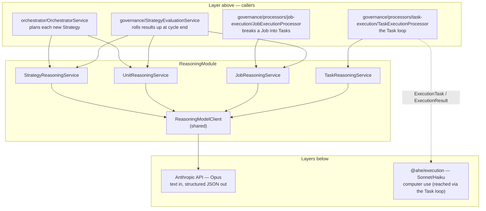
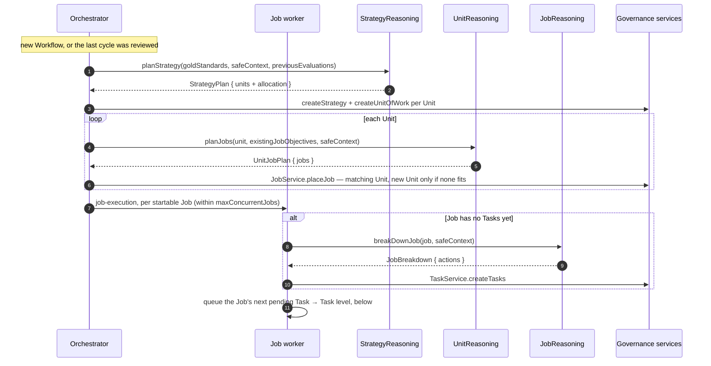
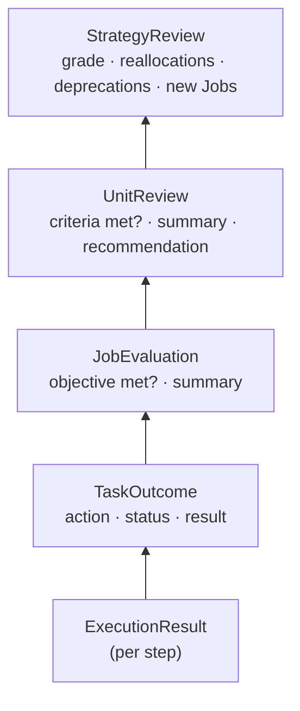
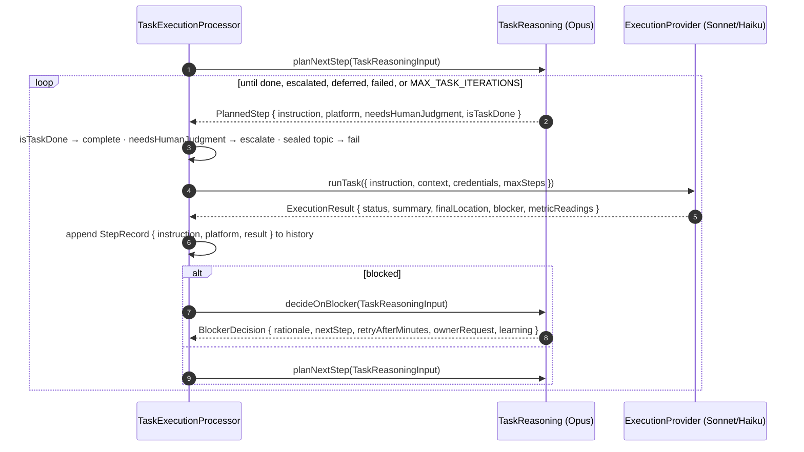

# Reasoning layer

The thinking half of AHE's [two-tier split](../../../../docs/base/02-system-architecture.md): every
planning, judging, and deciding call to Opus goes through this module. It is split into **one reasoner per
governance level** — Strategy, Unit of Work, Job, Task — that share a single model client.

- [Where it sits](#where-it-sits)
- [The four reasoners](#the-four-reasoners)
- [Planning flows down](#planning-flows-down)
- [Results flow up](#results-flow-up)
- [The Task level and the execution layer](#the-task-level-and-the-execution-layer)
- [Rules every reasoner follows](#rules-every-reasoner-follows)
- [Folder layout](#folder-layout)
- [Extending](#extending)

---

## Where it sits



- **Above:** the orchestrator, the governance processors, and the evaluation service call the reasoners. They load data, apply the
  [autonomy rules](../../../../docs/base/03-governance-model.md#autonomy-rules), and save the results; the reasoners
  only decide.
- **Below:** the reasoners call only `ReasoningModelClient`, which calls Opus. The module is a **leaf**: it
  imports no other backend module, holds no database access, and never calls the execution layer itself.
  The Task reasoner's decisions reach the screen only through the Task processor.

---

## The four reasoners

| Reasoner | Scope | Methods | Reads | Produces | Called by |
| --- | --- | --- | --- | --- | --- |
| `StrategyReasoningService` | The 30-day cycle | `planStrategy`, `reviewStrategy` | Gold standards, past evaluations, **Unit reviews** | `StrategyPlan` (Units + effort shares), `StrategyReview` | `OrchestratorService`, `StrategyEvaluationService` |
| `UnitReasoningService` | One theme of work | `planJobs`, `reviewUnit` | Success criteria, Unit metrics, **Job evaluations** | `UnitJobPlan`, `UnitReview` (grow / keep / shrink / deprecate) | `OrchestratorService`, `StrategyEvaluationService` |
| `JobReasoningService` | One objective | `breakDownJob`, `evaluateJob` | **Task outcomes** | `JobBreakdown` (Task actions), `JobEvaluation` | `JobExecutionProcessor`, `StrategyEvaluationService` |
| `TaskReasoningService` | One atomic action | `planNextStep`, `decideOnBlocker` | **`ExecutionResult`s**, unchanged, from the execution layer | `PlannedStep`, `BlockerDecision` | `TaskExecutionProcessor` |

The bold column is the point of the split: **each reasoner reads only the compressed output of the level
directly below it.** The Strategy reasoner never sees a Task; the Task reasoner never sees a screenshot.

| | Strategy | Unit | Job | Task |
| --- | --- | --- | --- | --- |
| Cadence | Once per cycle | When a Unit needs Jobs; cycle end | When a Job first starts; cycle end | Every step of a Task |
| Volume | Very low | Low | Medium | High — the hot path |

---

## Planning flows down

Planning walks down the hierarchy one level at a time. A new Strategy plans its Units and then each
Unit's Jobs in one pass; the orchestrator starts Jobs; a Job plans and starts its own Tasks.



---

## Results flow up

At the end of a cycle, `StrategyEvaluationService` rolls results up, compressing at every level.

```mermaid
sequenceDiagram
    autonumber
    participant E as StrategyEvaluationService
    participant J as JobReasoning
    participant U as UnitReasoning
    participant S as StrategyReasoning
    participant DB as Governance rows

    E->>DB: load Units, Jobs, Task outcomes, Unit measurements
    loop each Unit
        loop each Job in the Unit
            E->>J: evaluateJob(objective, task outcomes)
            J-->>E: JobEvaluation { isObjectiveMet, summary, followUpActions }
        end
        E->>U: reviewUnit(measurement, jobEvaluations)
        U-->>E: UnitReview { isMeetingCriteria, summary, recommendation, proposedJobs }
    end
    E->>S: reviewStrategy(goldStandards, values, unitReviews)
    S-->>E: StrategyReview { evaluation, reallocations, deprecations, newJobs }
    E->>DB: applyReview → Workflow back to running; the orchestrator plans the next Strategy
```

What crosses each boundary:



---

## The Task level and the execution layer

The Task reasoner is the only one that works step by step, and the only one whose decisions reach the
screen. The Task processor runs the loop between it and the execution layer; there is no router in
between:



- **One input, mirrored from execution.** Both methods take the same `TaskReasoningInput`
  (`taskAction`, `jobObjective`, `safeContext`, `history`, `recentChallengeCount`). Each `StepRecord` is the
  instruction sent plus the `ExecutionResult` returned, unchanged, so there is no separate summary type to keep
  in sync. Screenshots stay inside `@ahe/execution`.
- **No separate evaluation call.** `planNextStep` reads the latest result at the end of `history` and decides
  in one call: retry, move on, or `isTaskDone`.
- **Every step is on screen unless it ends the Task.** `PlannedStep` has no routing flag: the step is done,
  needs the owner, or goes to the execution layer. Thinking without the screen happens inside the call.
- **Credentials never pass through here.** The Task processor attaches the account login from `IdentityService`
  straight to the `ExecutionTask`; `PlannedStep.platform` only names the site.
- **Workarounds are open-ended; outcomes are not.** `decideOnBlocker` has no fixed menu of actions. The
  prompt gives examples (wait it out, another flow, the official API) and the model writes its own
  `nextStep`. The Task processor only reads which field is set: `ownerRequest` escalates, `retryAfterMinutes`
  defers, `nextStep` continues, and none of them fails the Task. Moving work to another platform belongs to
  the Unit of Work.
- **Gates are never solved.** Whatever the model plans must avoid the gate, not get past it; see
  [07 — Privacy & safety](../../../../docs/base/07-privacy-and-safety.md#platform-gates-and-accounts).

---

## Rules every reasoner follows

1. **Text only.** Inputs are summaries and safe context; nothing visual ever reaches Opus.
2. **One level down, never further.** A reasoner's input type contains only the output of the level below
   (see the table above). This keeps every prompt small and focused.
3. **Stateless.** Reasoners keep nothing between calls. Callers pass history (`StepRecord[]`, past
   evaluations) and persist results.
4. **Decide, don't act.** Reasoners return proposals. Governance applies them (autonomy rules, rows); the
   Task processor acts on them (execution, escalation, deferral).
5. **Privacy wall before, not inside.** `safeContext` arrives already filtered by `MemoryRetrievalService`;
   no reasoner can reach the memory system or the sealed zone.
6. **Structured output.** Every call goes through `ReasoningModelClient.completeStructured`, so each method
   returns a typed object, never free text to parse.

---

## Folder layout

```
reasoning/
├── reasoning.module.ts             ← provides the four reasoners + the client; exports the reasoners
├── reasoning-model.client.ts       ← Anthropic (Opus) wrapper shared by every level
├── types/completion-input.ts
├── strategy/
│   ├── strategy-reasoning.service.ts · strategy-reasoning.prompts.ts
│   └── types/                      ← plan-strategy-input, strategy-plan, planned-unit,
│                                      review-strategy-input, strategy-review, unit-reallocation
├── unit-of-work/
│   ├── unit-reasoning.service.ts · unit-reasoning.prompts.ts
│   └── types/                      ← plan-unit-jobs-input, unit-job-plan, planned-job,
│                                      review-unit-input, unit-review, unit-recommendation
├── job/
│   ├── job-reasoning.service.ts · job-reasoning.prompts.ts
│   └── types/                      ← break-down-job-input, job-breakdown,
│                                      evaluate-job-input, task-outcome, job-evaluation
└── task/
    ├── task-reasoning.service.ts · task-reasoning.prompts.ts
    └── types/                      ← task-reasoning-input, step-record, planned-step,
                                       blocker-decision
```

Each level's types live with the level that produces them; another level that consumes them imports
from there (e.g. `ReviewStrategyInput` imports `UnitReview` from `unit-of-work/types`).

---

## Extending

- **A new decision at a level** — add a method, its input and output types, and a prompt to that level's
  folder. Keep its input to the level's own data and the level below.
- **A different model per level** — the Task level runs on every step, so it is where cost
  concentrates. To move it (or any level) to another model, pass the model ID through `CompletionInput`
  from that level's service; the other levels are unaffected.
- **A new governance level** — add a folder with its reasoner, wire it into `ReasoningModule`, and slot it
  into the planning and review flows in governance.
- **Governance as tools (planned)** — governance services will later be exposed to the reasoners as tools
  (read Jobs, metrics, past evaluations; write through the autonomy rules). To keep this module a leaf,
  each reasoner will receive its level's tools as an argument instead of importing governance, with every
  write tool enforcing the governance rules itself.

All reasoner methods and the model client are currently stubs (`NotImplementedException`); the prompts are
placeholders marked `TODO`. The Task processor that calls the Task reasoner is implemented and unit-tested
against fakes.
