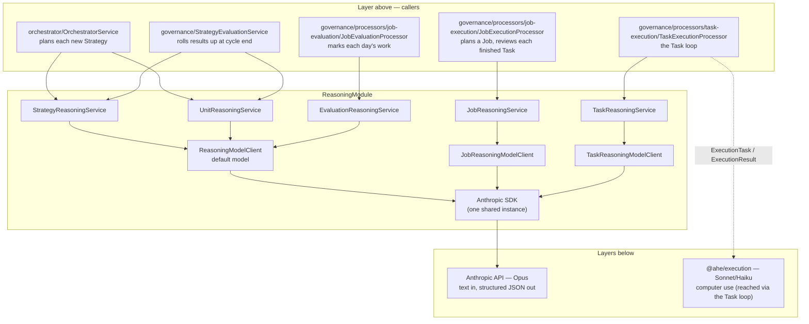
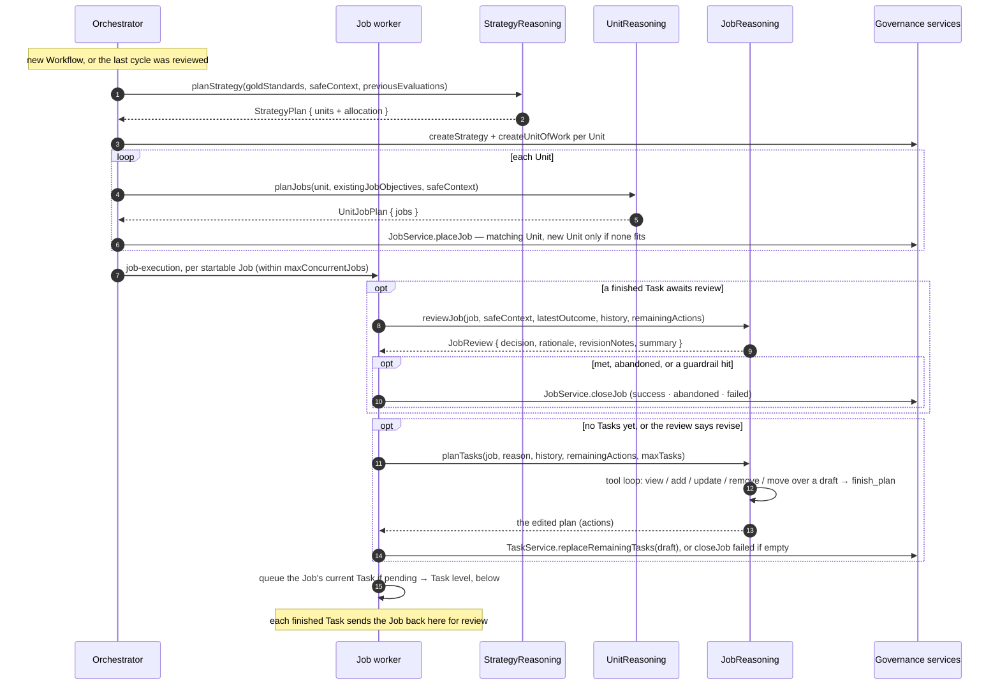
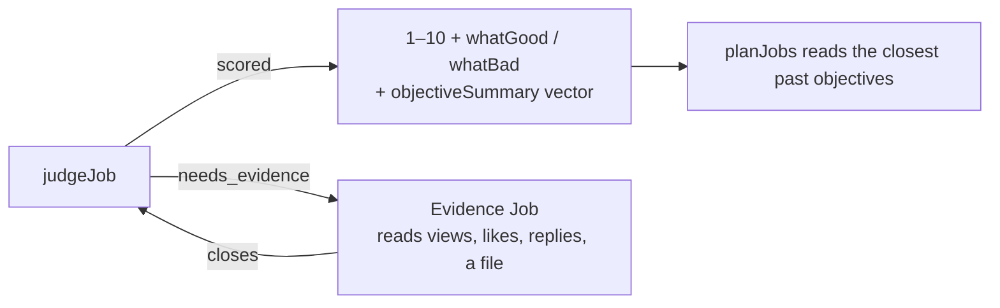
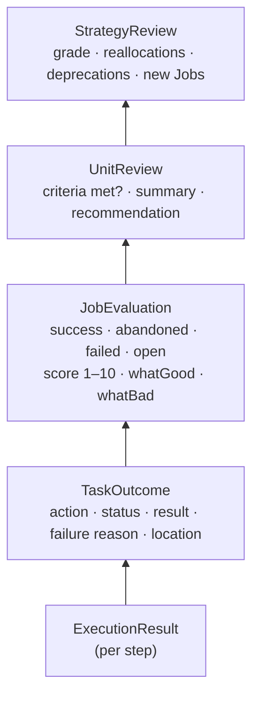
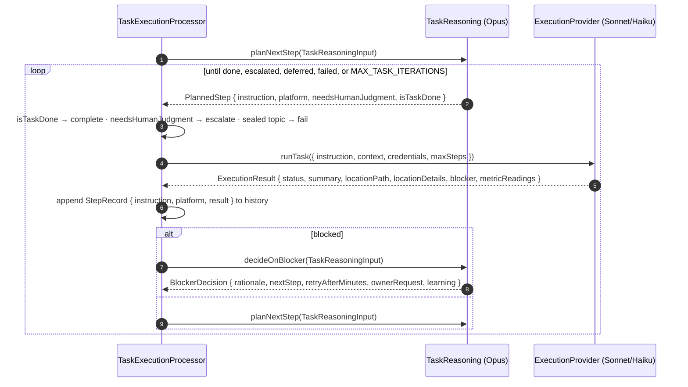

# Reasoning layer

The thinking half of AHE's [two-tier split](../../../../docs/base/02-system-architecture.md): every
planning, judging, and deciding call to Opus goes through this module. It is split into **one reasoner per
governance level** — Strategy, Unit of Work, Job, Task — plus the **evaluator** that marks finished work,
each calling the model through a model client configured for its level, over one shared Anthropic instance.

- [Where it sits](#where-it-sits)
- [The reasoners](#the-reasoners)
- [Planning flows down](#planning-flows-down)
- [Job review and planning](#job-review-and-planning)
- [Marking finished work](#marking-finished-work)
- [Results flow up](#results-flow-up)
- [The Task level and the execution layer](#the-task-level-and-the-execution-layer)
- [Model clients and config](#model-clients-and-config)
- [Rules every reasoner follows](#rules-every-reasoner-follows)
- [Folder layout](#folder-layout)
- [Extending](#extending)

---

## Where it sits



- **Above:** the orchestrator, the governance processors, and the evaluation service call the reasoners. They load data, apply the
  [autonomy rules](../../../../docs/base/03-governance-model.md#autonomy-rules), and save the results; the reasoners
  only decide.
- **Below:** the reasoners call only their model client (`ReasoningModelClient` or a level subclass),
  which calls the model. The module is a **leaf**: it
  imports no other backend module, holds no database access, and never calls the execution layer itself.
  The Task reasoner's decisions reach the screen only through the Task processor.

---

## The reasoners

| Reasoner | Scope | Methods | Reads | Produces | Called by |
| --- | --- | --- | --- | --- | --- |
| `StrategyReasoningService` | The 30-day cycle | `planStrategy`, `reviewStrategy` | Gold standards, past evaluations, **Unit reviews** | `StrategyPlan` (Units + effort shares), `StrategyReview` | `OrchestratorService`, `StrategyEvaluationService` |
| `UnitReasoningService` | One theme of work | `planJobs`, `reviewUnit` | Success criteria, Unit metrics, **Job evaluations** | `UnitJobPlan`, `UnitReview` (grow / keep / shrink / deprecate) | `OrchestratorService`, `StrategyEvaluationService` |
| `JobReasoningService` | One objective | `reviewJob`, `planTasks` | **Task outcomes** | `JobReview` (continue / revise / met / abandon), plan edits through tools | `JobExecutionProcessor` |
| `TaskReasoningService` | One atomic action | `planNextStep`, `decideOnBlocker` | **`ExecutionResult`s**, unchanged, from the execution layer | `PlannedStep`, `BlockerDecision` | `TaskExecutionProcessor` |
| `EvaluationReasoningService` | One finished Job | `judgeJob` | **Task outcomes**, the Unit's criteria, gathered evidence | `ScoredJob` (1–10 + `whatGood` / `whatBad`) or an `EvidenceRequest` | `JobEvaluationProcessor` |

The bold column is the point of the split: **each reasoner reads only the compressed output of the level
directly below it.** The Strategy reasoner never sees a Task; the Task reasoner never sees a screenshot.

| | Strategy | Unit | Job | Task |
| --- | --- | --- | --- | --- |
| Cadence | Once per cycle | When a Unit needs Jobs; cycle end | When a Job starts, after every finished Task | Every step of a Task |
| Volume | Very low | Low | Medium | High — the hot path |

The evaluator sits beside the Job level rather than on it: it runs once a day over the Jobs that saw
activity, so its volume follows how much work the agent did that day.

---

## Planning flows down

Planning walks down the hierarchy one level at a time. A new Strategy plans its Units and then each
Unit's Jobs in one pass; the orchestrator starts Jobs; a Job plans its own Tasks and revises the plan
after each one finishes.



---

## Job review and planning

A Job uses two separate calls, so each one has a single job:

| Method | When | How | Output |
| --- | --- | --- | --- |
| `reviewJob` | After every finished Task | One structured call (`completeStructured`) | `JobReview`: `decision`, `rationale`, `revisionNotes`, `summary` |
| `planTasks` | First plan; `revise` | A tool loop (`runToolLoop`) over the planning tools | The edited plan: Task actions, in order |

`reviewJob` reads the Task that **just finished** (`latestOutcome`) apart from the earlier ones (`history`,
cancelled Tasks included, so dropped work stays visible) and the remaining plan:

| `decision` | Meaning | What the Job processor does |
| --- | --- | --- |
| `continue` | The plan still fits | Keeps it. With nothing left to run, the Job stays open and idle for now (see `docs/todo.md`) |
| `revise` | The plan should change | Calls `planTasks` with `revisionNotes` as the reason |
| `met` | The objective is achieved | Closes the Job as `success` with `summary` |
| `abandon` | **We decided to stop** — not worth continuing | Closes the Job as `abandoned` with `rationale` |

`planTasks` gets the reason it was called, the history, the current plan, and the Task limit. It gets a new
`JobPlanningToolset` from `ToolsetFactory.createJobPlanningToolset` — tools over an in-memory draft that
enforce the limit — runs the loop with its tools, and returns the draft. The toolset is local to that call,
so no draft is shared between Jobs. The Job processor saves the result in one
write, so a run that crashes halfway changes nothing. Saving is governance's job; the module stays a leaf.

Job reasoning never declares `failed`: **failed means "we couldn't do it"** and is set by the system — too
many failed Tasks in a row, an empty plan, or the Task cap (see the
[processors spec](../governance/processors/tech-spec.md#how-a-job-ends)). The review prompt tells the model
not to abandon because Tasks keep failing, so the two outcomes stay distinct signals.

---

## Marking finished work

`judgeJob` is the agent grading itself. Once a day, every Job that saw activity is marked out of 10 with
one sentence on what was good and one on what was bad. Those marks are the only memory the planner has of
how its own work landed.

| | |
| --- | --- |
| Who picks the standard | The model does. The objective's own bar first, then the Unit's success criteria, then the test that kind of work deserves — stated back in `rubric` |
| How the scale is held | Anchored in the prompt: 1–3 not met, 4–6 partly, 7–8 met, 9–10 exceeded *with evidence*. Without anchors a 1–10 scale collapses to "everything is a 7" |
| Who the feedback is for | The next planner, not the owner. `whatGood` and `whatBad` name the decision, not the outcome: "led with a question, which pulled replies", not "the post did well" |
| What `objectiveSummary` is for | Finding this Job again. Written in general terms — kind of work, medium, intent — because it is the text the planner's search is matched against |

**When the outcome is not on record, it does not guess.** A post judged minutes after it went up has no
engagement yet. Rather than inventing a number, the evaluator returns an `EvidenceRequest`: a real Job,
filed under the Strategy's Evaluations Unit, that goes and reads the figures through the execution layer.
The judgement parks until that Job closes and is then marked on what came back. One round only — the
second call is told the evidence is in and must mark on it.



Evidence Jobs are never themselves marked, so this cannot feed on itself.

---

## Results flow up

At the end of a cycle, `StrategyEvaluationService` rolls results up, compressing at every level. No Job is
judged here: each was already marked on the day it ran.

```mermaid
sequenceDiagram
    autonumber
    participant E as StrategyEvaluationService
    participant U as UnitReasoning
    participant S as StrategyReasoning
    participant DB as Governance rows

    E->>DB: load Units, Unit measurements, stored job_evaluations rows
    loop each Unit
        Note over E: the Unit's Jobs were marked day by day; nothing is judged now
        E->>U: reviewUnit(measurement, jobEvaluations)
        U-->>E: UnitReview { isMeetingCriteria, summary, recommendation, proposedJobs }
    end
    E->>S: reviewStrategy(goldStandards, values, unitReviews)
    S-->>E: StrategyReview { evaluation, reallocations, deprecations, newJobs }
    E->>DB: applyReview → Workflow back to running; the orchestrator plans the next Strategy
```

What crosses each boundary:



**Abandoned and failed read differently upward.** `reviewUnit` treats abandoned Jobs as a strategic
signal about the Unit (wrong place, wrong audience — an argument to shrink or deprecate it) and failed
Jobs as an execution signal (try different Jobs or approaches inside the Unit). `reviewStrategy` applies
the same reading when it reallocates or deprecates Units.

---

## The Task level and the execution layer

The Task reasoner is the only one that works step by step, and the only one whose decisions reach the
screen. The Task processor runs the loop between it and the execution layer; there is no router in
between:



- **One input, mirrored from execution.** Both methods take the same `TaskReasoningInput`
  (`taskAction`, `jobObjective`, `safeContext`, `history`, `recentChallengeCount`). Each `StepRecord` is the
  instruction sent plus the `ExecutionResult` returned, unchanged, so there is no separate summary type to keep
  in sync. Screenshots stay inside `@ahe/execution`.
- **No separate evaluation call.** `planNextStep` reads the latest result at the end of `history` and decides
  in one call: retry, move on, or `isTaskDone`.
- **Every step is on screen unless it ends the Task.** `PlannedStep` has no routing flag: the step is done,
  needs the owner, or goes to the execution layer. Thinking without the screen happens inside the call.
- **Credentials never pass through here.** The Task processor attaches the account login from `IdentityService`
  straight to the `ExecutionTask`; `PlannedStep.platform` only names the site.
- **Workarounds are open-ended; outcomes are not.** `decideOnBlocker` has no fixed menu of actions. The
  prompt gives examples (wait it out, another flow, the official API) and the model writes its own
  `nextStep`. The Task processor only reads which field is set: `ownerRequest` escalates, `retryAfterMinutes`
  defers, `nextStep` continues, and none of them fails the Task. Moving work to another platform belongs to
  the Unit of Work.
- **Gates are never solved.** Whatever the model plans must avoid the gate, not get past it; see
  [07 — Privacy & safety](../../../../docs/base/07-privacy-and-safety.md#platform-gates-and-accounts).

---

## Model clients and config

`ReasoningModule` builds the clients with factory providers; nothing in the module reads env vars
directly. `reasoning.config.ts` (`registerAs('reasoning')`) reads them once and fails at boot when a
required one is missing.

| Provider | Built from | Used by | Model | Effort |
| --- | --- | --- | --- | --- |
| `ANTHROPIC_CLIENT` | `ANTHROPIC_API_KEY` | every model client | — | — |
| `ReasoningModelClient` | `ANTHROPIC_CLIENT` + `defaultModel` | `StrategyReasoningService`, `UnitReasoningService` | `REASONING_MODEL_ID` | high |
| `JobReasoningModelClient` | `ANTHROPIC_CLIENT` + `jobModel` | `JobReasoningService` | `REASONING_JOB_MODEL_ID`, else the default | high |
| `TaskReasoningModelClient` | `ANTHROPIC_CLIENT` + `taskModel` | `TaskReasoningService` | `REASONING_TASK_MODEL_ID`, else the default | medium (hot path) |

The subclasses add no behaviour; they exist so each service injects its level's client by class. A level
that needs its own model or effort gets a subclass and a settings entry in the config; Strategy and Unit
run rarely, so they share the default.

**How a call works.** `completeStructured` calls `messages.parse` with adaptive thinking and the method's
zod schema as the JSON schema output format (`output_config.format`). The model thinks first, then must
answer in that shape; the SDK parses the answer into `parsed_output`. A reply that stops for any reason
other than `end_turn` (cut off at `maxTokens`, refused) throws, so the caller's queue retry handles it.
`maxTokens` covers thinking and the answer together; it stays under the SDK's non-streaming limit.

**How a tool loop works.** `runToolLoop` calls `messages.create` with adaptive thinking and the tools
(`strict: true`, input schemas from zod). Each turn's content goes back as the assistant message, so
thinking carries over. Every tool call is checked against its schema; an unknown tool, invalid input, or a
`ReasoningToolError` goes back as an `is_error` result for the model to fix. A turn with no tool call gets
a nudge. The loop ends when the tool marked `endsLoop` succeeds, and throws after `maxTurns` or on a
`max_tokens` / `refusal` stop.

---

## Rules every reasoner follows

1. **Text only.** Inputs are summaries and safe context; nothing visual ever reaches Opus.
2. **One level down, never further.** A reasoner's input type contains only the output of the level below
   (see the table above). This keeps every prompt small and focused.
3. **Stateless.** Reasoners keep nothing between calls. Callers pass history (`StepRecord[]`, past
   evaluations) and persist results.
4. **Decide, don't act.** Reasoners return proposals. Governance applies them (autonomy rules, rows); the
   Task processor acts on them (execution, escalation, deferral).
5. **Privacy wall before, not inside.** `safeContext` arrives already filtered by `MemoryRetrievalService`;
   no reasoner can reach the memory system or the sealed zone.
6. **Structured output.** Every call goes through `completeStructured` on the level's model client with a
   zod schema (`<level>/schemas/`), so each method returns a typed object, never free text to parse. Types
   that the model produces are inferred from their schema. The one exception is Job planning, which uses
   `runToolLoop`; its tools have zod input schemas too.

---

## Folder layout

```
reasoning/
├── reasoning.module.ts             ← factory providers for the Anthropic SDK + model clients; every reasoner
├── reasoning.config.ts             ← registerAs('reasoning'): API key + model per level
├── reasoning.tokens.ts             ← ANTHROPIC_CLIENT
├── reasoning-model.client.ts       ← base model client (structured call + tool loop); Strategy and Unit use it as is
├── reasoning-tool.error.ts         ← thrown by a tool to send an error result back to the model
├── tools/toolset.factory.ts        ← ToolsetFactory: a new toolset per run (+ tests/)
├── task-outcome.prompts.ts         ← renders Task outcomes as prompt text, shared by Job and evaluation prompts
├── types/                          ← completion-input, tool-loop-input, reasoning-tool, reasoning-model-settings
├── tests/                          ← reasoning.module (wiring), reasoning-model.client (structured call, tool loop)
├── strategy/
│   ├── strategy-reasoning.service.ts · strategy-reasoning.prompts.ts
│   └── types/                      ← plan-strategy-input, strategy-plan, planned-unit,
│                                      review-strategy-input, strategy-review, unit-reallocation
├── unit-of-work/
│   ├── unit-reasoning.service.ts · unit-reasoning.prompts.ts
│   └── types/                      ← plan-unit-jobs-input, unit-job-plan, planned-job,
│                                      review-unit-input, unit-review, unit-recommendation
├── job/
│   ├── job-reasoning.service.ts · job-reasoning-model.client.ts · job-reasoning.constants.ts
│   ├── job-reasoning.prompts.ts     ← system prompt + user-prompt renderer per method
│   ├── tools/job-planning-toolset.ts ← the planning tools over an in-memory draft (+ tests/)
│   ├── schemas/job-review.schema.ts ← zod; the output format
│   ├── tests/job-reasoning.service.spec.ts
│   └── types/                      ← job-review-input, job-review, job-review-decision, job-planning-input,
│                                      task-outcome
├── task/
│   ├── task-reasoning.service.ts · task-reasoning.prompts.ts · task-reasoning-model.client.ts
│   └── types/                      ← task-reasoning-input, step-record, planned-step,
│                                      blocker-decision
└── evaluation/
    ├── evaluation-reasoning.service.ts · evaluation-reasoning.prompts.ts · evaluation-reasoning.constants.ts
    ├── schemas/job-judgement-output.schema.ts
    ├── tests/evaluation-reasoning.service.spec.ts
    └── types/                      ← judge-job-input, gathered-evidence, job-judgement, scored-job,
                                       evidence-request, job-judgement-verdict, job-evaluation
```

Each level's types live with the level that produces them; another level that consumes them imports
from there (e.g. `ReviewStrategyInput` imports `UnitReview` from `unit-of-work/types`).

---

## Extending

- **A new decision at a level** — add a method, its input and output types, and a prompt to that level's
  folder. Keep its input to the level's own data and the level below.
- **A different model per level** — set `REASONING_JOB_MODEL_ID` or `REASONING_TASK_MODEL_ID`. The Task
  level runs on every step, so it is where cost concentrates. To give Strategy or Unit their own model,
  add a subclass, a settings entry in `reasoning.config.ts`, and a factory provider, as for Job and Task.
- **A new governance level** — add a folder with its reasoner, wire it into `ReasoningModule`, and slot it
  into the planning and review flows in governance.
- **Governance as tools (planned)** — governance services will later be exposed to the reasoners as tools
  (read Jobs, metrics, past evaluations; write through the autonomy rules). To keep this module a leaf,
  each reasoner will receive its level's tools as an argument instead of importing governance, with every
  write tool enforcing the governance rules itself.

`ReasoningModelClient`, `JobReasoningService`, and `EvaluationReasoningService` are implemented; the Strategy, Unit, and Task reasoners
are still stubs (`NotImplementedException`). The Job prompts are complete; the `decideOnBlocker`,
`reviewUnit`, and `reviewStrategy` prompts have their rules written and still end in `TODO`. The Task processor that calls the Task reasoner is implemented and unit-tested
against fakes.
