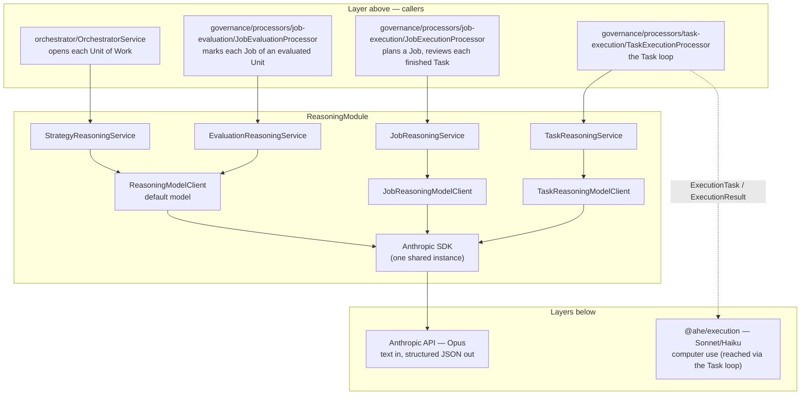
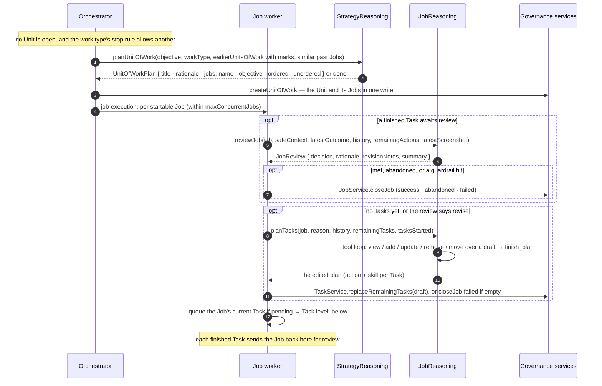
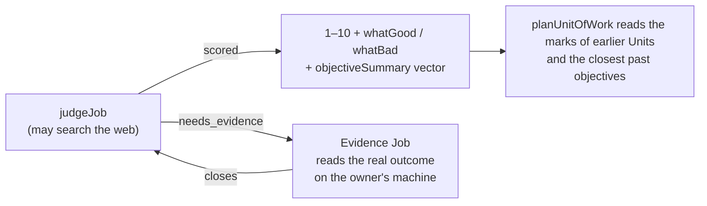
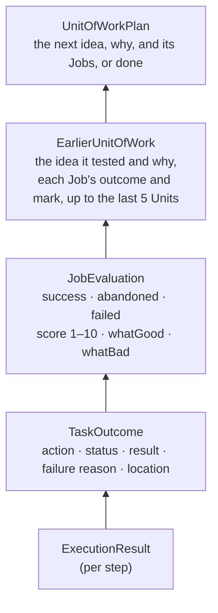
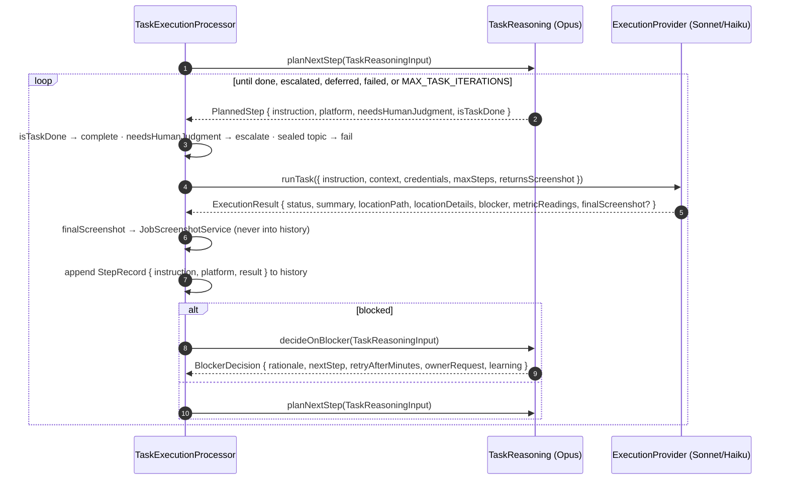

# Reasoning layer

The thinking half of AHE's [two-tier split](../../../../docs/base/02-system-architecture.md): every
planning, evaluating, and deciding call to Opus goes through this module. It is split into **one reasoner per
governance level that decides something** — Strategy, Job, Task — plus the **evaluator** that marks
finished work, each calling the model through a model client configured for its level, over one shared
Anthropic instance. A Unit of Work only groups Jobs, so it has no reasoner: the Strategy planner fills each
Unit with Jobs.

- [Where it sits](#where-it-sits)
- [The reasoners](#the-reasoners)
- [Planning flows down](#planning-flows-down)
- [Job review and planning](#job-review-and-planning)
- [Marking finished work](#marking-finished-work)
- [Planning the next Unit](#planning-the-next-unit)
- [The Task level and the execution layer](#the-task-level-and-the-execution-layer)
- [Model clients and config](#model-clients-and-config)
- [Rules every reasoner follows](#rules-every-reasoner-follows)
- [Folder layout](#folder-layout)
- [Extending](#extending)

---

## Where it sits



- **Above:** the orchestrator and the governance processors call the reasoners. They load data, apply the
  [autonomy rules](../../../../docs/base/03-governance-model.md#autonomy-rules), and save the results; the reasoners
  only decide.
- **Below:** the reasoners call only their model client (`ReasoningModelClient` or a level subclass),
  which calls the model. The module is a **leaf**: it
  imports no other backend module, holds no database access, and never calls the execution layer itself.
  The Task reasoner's decisions reach the screen only through the Task processor.

---

## The reasoners

| Reasoner | Scope | Methods | Reads | Produces | Called by |
| --- | --- | --- | --- | --- | --- |
| `StrategyReasoningService` | The whole Strategy | `planUnitOfWork` | The objective, the work type, **the Job outcomes and marks** of earlier Units, similar past Jobs, and what it finds on the web | `UnitOfWorkPlan`: the next Unit's Jobs, each `ordered` or `unordered` — or `done` | `OrchestratorService` |
| `JobReasoningService` | One objective | `reviewJob`, `planTasks` | **Task outcomes**, and the final screenshot of a visual Task | `JobReview` (continue / revise / met / abandon), plan edits through tools, each Task with its skill | `JobExecutionProcessor` |
| `TaskReasoningService` | One atomic action | `planNextStep`, `decideOnBlocker` | **`ExecutionResult`s**, unchanged, from the execution layer, and the Job's earlier Task outcomes | `PlannedStep`, `BlockerDecision` | `TaskExecutionProcessor` |
| `EvaluationReasoningService` | One finished Job | `judgeJob` | **Task outcomes**, the final screenshot of visual work, the Strategy's objective, gathered evidence, the web | `ScoredJob` (1–10 + `whatGood` / `whatBad`) or an `EvidenceRequest` | `JobEvaluationProcessor` |

The bold column is the point of the split: **each reasoner reads only the compressed output of the level
directly below it.** The Strategy reasoner never sees a Task; the Task reasoner never sees a screenshot.
The one picture that goes up is the final screen of a visual Task, to Job review and the evaluator (see
[Task skills](#task-skills)).

| | Strategy | Job | Task |
| --- | --- | --- | --- |
| Cadence | Once per Unit of Work | When a Job starts, after every finished Task | Every step of a Task |
| Volume | Very low | Medium | High — the hot path |

The evaluator sits beside the Job level rather than on it: it runs once per Job, after the Job's Unit has
finished, so its volume follows how much work the agent did.

---

## Planning flows down

Planning walks down the hierarchy one level at a time. The orchestrator opens one Unit of Work at a time
and the Strategy planner fills it with Jobs; the orchestrator starts Jobs; a Job plans its own Tasks and
revises the plan after each one finishes.



---

## Job review and planning

A Job uses two separate calls, so each one has a single job:

| Method | When | How | Output |
| --- | --- | --- | --- |
| `reviewJob` | After every finished Task | One structured call (`completeStructured`) | `JobReview`: `decision`, `rationale`, `revisionNotes`, `summary` |
| `planTasks` | First plan; `revise` | A tool loop (`runToolLoop`) over the planning tools | The edited plan: `PlannedTask`s (action and `skillType`), in order |

`reviewJob` reads the Task that **just finished** (`latestOutcome`) apart from the earlier ones (`history`,
cancelled Tasks included, so dropped work stays visible) and the remaining plan. When the latest Task's
skill returns screenshots, its final screen is attached as an image (`latestScreenshot`), and the prompt
says to judge visual work by what it shows: the wrong design, or a weak one, is a `revise`.

| `decision` | Meaning | What the Job processor does |
| --- | --- | --- |
| `continue` | The plan still fits | Keeps it. With nothing left to run, calls `planTasks` to plan what is left, so the Job never sits idle |
| `revise` | The plan should change | Calls `planTasks` with `revisionNotes` as the reason |
| `met` | The objective is achieved | Closes the Job as `success` with `summary` |
| `abandon` | **We decided to stop** — not worth continuing | Closes the Job as `abandoned` with `rationale` |

`planTasks` gets the reason it was called, the history, the current plan, and how many Tasks have started. It
gets a new `JobPlanningToolset` from `ToolsetFactory.createJobPlanningToolset` — tools over an in-memory
draft — runs the loop with its tools, and returns the draft. The Task budget (`TASK_BUDGET_PER_JOB`, about 20
per Job, and about 5 added per revision) is **soft**: the prompt states it, and the model may go over it
when the objective genuinely needs more Tasks, saying why in its rationale. Only the hard limit
`MAX_TASKS_PER_JOB` (60, three times the budget) is enforced: the toolset gets the room left under it and
`add_task` refuses past that, and the prompt states the limit so the model plans the most important work
first. The toolset is local to that call,
so no draft is shared between Jobs. The Job processor saves the result in one
write, so a run that crashes halfway changes nothing. Saving is governance's job; the module stays a leaf.

Job reasoning never declares `failed`: **failed means "we couldn't do it"** and is set by the system — too
many failed Tasks in a row, an empty plan, or the hard Task limit (see the
[processors spec](../governance/processors/tech-spec.md#how-a-job-ends)). The review prompt tells the model
not to abandon because Tasks keep failing, so the two outcomes stay distinct signals.

---

## Marking finished work

`judgeJob` is the agent grading itself. Once a Unit of Work has finished, each of its Jobs is marked out of
10 with one sentence on what was good and one on what was bad — at once for `one_off` and `multi_version`
work, a day later for `continuous` work so engagement can arrive. Those marks are the only memory the
planner has of how its own work landed.

| | |
| --- | --- |
| Who picks the standard | The model does. The objective's own bar first, then what the Strategy as a whole is trying to achieve, then the test that kind of work deserves — stated back in `rubric`. Where it has no sound basis for any of those, it searches the web for how the work is done well rather than marking on instinct |
| How the scale is held | Anchored in the prompt: 1–3 not met, 4–6 partly, 7–8 met, 9–10 exceeded *with evidence*. Without anchors a 1–10 scale collapses to "everything is a 7" |
| Who the feedback is for | The next planner, not the owner. `whatGood` and `whatBad` name the decision, not the outcome: "led with a question, which pulled replies", not "the post did well" |
| What `objectiveSummary` is for | Finding this Job again. Written in general terms — kind of work, medium, intent — because it is the text the planner's search is matched against |

**When it does not know, it does not guess — it goes and finds out.** An evaluation can be short of two
different things, and what is missing decides how it is fetched.

| What is missing | How it is fetched | Why that way |
| --- | --- | --- |
| **The standard.** The evaluator cannot say what good would have looked like for this kind of work | It searches the web mid-evaluation, up to `JUDGE_JOB_MAX_SEARCHES` times, and answers in the same call | This is public knowledge. Sending a Job out for it would cost a planning round and a browser session to learn something a search answers in seconds |
| **The work itself.** A post evaluated minutes after it went up has no engagement yet; a video or a design cannot be evaluated from the fact that it was exported | It returns an `EvidenceRequest`, which becomes a real Job in the Unit being evaluated. The evaluation parks until that Job closes, then marks on what came back | No search can reach this. A logged-in account, a file on disk, a project open in an editor — only a Job on the owner's machine opens any of them |

Searching for the standard is for **aspiration, not imitation**: the feedback says what would have lifted
the Job towards it — the angle, the shape, the level of craft — and never tells the planner to reproduce
what it found. The next Job has to be the agent's own work, as good as the best of its kind.

**Work that lives in a file is reachable because the location travels with the Task.** A Task that renders
a video or edits a design reports `locationPath` (the absolute file path, or the app name) and
`locationDetails` (the steps to reach a view inside software), and both are printed into the evaluator's
prompt as `Location:` and `How to get there:`. The evaluator quotes them into the errand, so the evidence
Job knows what to open and where.

**Visual work comes with its picture.** When a Job ran a skill that returns screenshots (a design), the
evaluator gets the Job's newest screenshot as an image and marks the look from it. It asks for evidence
only for what the picture cannot show, such as responses or other pages.

Without a screenshot, the evaluator cannot look at the work, and the one agent with eyes is the
computer-use agent carrying out the errand. The evaluator therefore sends **criteria, not a question**: `evidenceCriteria` is a list of `{ key, whatToExamine }` drawn from what
it just learnt about how this kind of work is done well, and the processor renders them into the errand's
objective with the key each reading must come back under.

That turns prose into numbers. The errand opens the work once, rates each criterion, and reports them as
`metricReadings` — which is a `Record<string, number>` with no size limit, unlike the 100-word summary — and
those readings are printed straight back into the second evaluating pass as `Metrics: title_legibility=8`. The
evaluator sets the standard, the execution layer applies its eyes, and the mark comes from both.

An outcome that is only a figure on a page needs no criteria, and `evidenceCriteria` is empty for it.

Evidence is one round only — the second call is told the evidence is in and must mark on it.



Evidence Jobs are never themselves marked, so this cannot feed on itself.

---

## Planning the next Unit

Results flow up through one call. When the orchestrator opens a Unit, `planUnitOfWork` reads how the Jobs of the
Strategy's earlier Units ended and how they were marked, and writes the next Unit's Jobs from that. There is
no separate review step: learning happens between Units.



| Input | What it carries |
| --- | --- |
| `objective`, `workType`, `unitOfWorkName`, `unitOfWorkLimit` | What the owner wants, how the work is shaped, and which Unit this is ("Attempt 2 of at most 3") |
| `earlierUnitsOfWork` | The Strategy's last `EARLIER_UNITS_OF_WORK_LIMIT` Units, each with its `title` (the idea it tested) and `rationale` (why), and each Job with its order type, outcome, and mark. A recent `continuous` round may not be evaluated yet; the planner learns from its outcomes and plans anyway |
| `relatedEvaluations` | Scored Jobs from the owner's other Strategies with a similar objective, by vector search |
| `canFinish` | True only for a `one_off` Strategy after its first attempt. Then the planner may answer `done` when the marks show the deliverable is good enough |

**Each Unit of Work names its idea.** The answer has a `title`, the one idea the Unit tests ("Shorter hook,
post at 9am instead of 3am"), and a `rationale`, why. Both are stored on the Unit, shown in
`GET /workflows/:id/progress`, and shown to the planner of every later Unit, so it can tell which ideas
worked and not only how each Job went. A blank title falls back to the first Job's name.

**Each work type plans differently.** A `continuous` round keeps what is working and adds one or two new
experiments. A `one_off` attempt fixes what the marks said was wrong with the last one. A `multi_version`
version takes a deliberately different direction from the versions before it.

**Ordered Jobs are a chain.** The planner marks a Job `ordered` when it needs the result of the one before:
cut, then colour, then export. Ordered Jobs run one at a time in the listed order; if one fails, the rest
of the chain is skipped. Everything else is `unordered` and runs alongside.

**An unusable answer throws.** No Jobs, or `done` where it is not allowed, throws, so the orchestrator tries
again on its next pass. Jobs with an empty objective are dropped, at most `MAX_JOBS_PER_UNIT_OF_WORK` (8) are kept,
and a blank name falls back to the objective.

**Abandoned and failed read differently.** The prompt treats an abandoned Job as a signal about the idea
(wrong place, wrong audience) and a failed one as a signal about the approach.

---

## The Task level and the execution layer

The Task reasoner is the only one that works step by step, and the only one whose decisions reach the
screen. The Task processor runs the loop between it and the execution layer; there is no router in
between:



- **One input, mirrored from execution.** Both methods take the same `TaskReasoningInput`
  (`taskAction`, `skillType`, `jobObjective`, `safeContext`, `earlierTasks`, `history`, `recentChallengeCount`).
  Each `StepRecord` is the instruction sent plus the `ExecutionResult` returned, without its screenshot, so
  there is no separate summary type to keep in sync.
- **Earlier Tasks are context.** `earlierTasks` holds the Job's Tasks that finished before this one, with their
  results and locations, rendered as `<EARLIER_TASKS_IN_THIS_JOB>`. The execution context gets the latest
  `EARLIER_TASKS_IN_EXECUTION_CONTEXT` (10) of them too, so both levels build on earlier work (the design's
  edit link, say) instead of searching for it again.
- **No separate evaluation call.** `planNextStep` reads the latest result at the end of `history` and decides
  in one call: retry, move on, or `isTaskDone`. It is one structured call (`PLANNED_STEP_SCHEMA`, at most
  `PLAN_NEXT_STEP_MAX_TOKENS`) that renders every step so far with its status, result, metrics, location,
  and blocker. Each instruction must stand alone, because the execution agent remembers nothing between
  steps. A done answer drops the instruction; a step that is neither done nor has an instruction throws, so
  the Task fails and Job reasoning reviews it. A blank `platform` becomes null.
- **`decideOnBlocker` is not built yet.** A blocked step throws, so the Task fails and Job reasoning reviews
  it. Its draft prompt in `task-reasoning.prompts.ts` is the starting point.
- **Every step is on screen unless it ends the Task.** `PlannedStep` has no routing flag: the step is done,
  needs the owner, or goes to the execution layer. Thinking without the screen happens inside the call.
- **Credentials never pass through here.** The Task processor attaches the account login from `IdentityService`
  straight to the `ExecutionTask`; `PlannedStep.platform` only names the site.
- **Workarounds are open-ended; outcomes are not.** `decideOnBlocker` has no fixed menu of actions. The
  prompt gives examples (wait it out, another flow, the official API) and the model writes its own
  `nextStep`. The Task processor only reads which field is set: `ownerRequest` escalates, `retryAfterMinutes`
  defers, `nextStep` continues, and none of them fails the Task. Moving work to another platform belongs to
  the Strategy planner.
- **Gates are never solved.** Whatever the model plans must avoid the gate, not get past it; see
  [07 — Privacy & safety](../../../../docs/base/07-privacy-and-safety.md#platform-gates-and-accounts).

---

## Task skills

A **skill** is how Task reasoning works on one kind of Task. Job reasoning picks one for every Task it plans
(the `skill` field of `add_task` and `update_task`), and the Task row stores it as `skillType`, default
`general`. The first live Canva run showed why: one generic prompt planned 26 small Tasks, 18 of them only
checking the design, because each step was short and nothing above the Task could see the result.

| `skillType` | `maxExecutionSteps` | `returnsScreenshot` | What changes from `general` |
| --- | --- | --- | --- |
| `general` | 30 | no | The base: today's step rules, the owner as a last resort, pacing |
| `creative_design` | 150 | yes | `STEPS`: one long step per piece of design, never a step that only measures. Adds `CRAFT` |
| `social_post` | 30 | no | Adds `CRAFT`: write every post in full, read the community rules first, report the permalink |

**Skills are data, built with `TaskSkillBuilder`.** In `task/skills/`, `builder/` holds the mechanics (the builder,
the `TaskSkill` type, the sections, the renderer, and the `TASK_SKILLS` registry), and `specialist/` holds one file
per skill, `general.skill.ts` included. Code outside `skills/` imports only from `skills/index.ts`. A skill starts
`.from(GENERAL_SKILL)` and replaces or adds sections with `.withSection(name, text)`; a section can never be
removed. `.build()` checks that the required sections (`SITUATION`, `STEPS`, `DONE`, `OWNER`, `RULES`) are set
and the step limit is at least 1, and returns the skill frozen. `renderTaskSkillPrompt` turns the sections into
the system prompt, one `<SECTION>` block each, in the fixed order of `TASK_SKILL_SECTIONS`.

```ts
export const CREATIVE_DESIGN_SKILL = new TaskSkillBuilder('creative_design')
  .from(GENERAL_SKILL)
  .withSection('STEPS', STEPS)
  .withSection('CRAFT', CRAFT)
  .withMaxExecutionSteps(150)
  .returnsScreenshot()
  .build();
```

`TASK_SKILLS` maps every `TaskSkillType` to its skill, and the planner's one-line guide per skill is a
`Record<TaskSkillType, string>`, so a new type in `@ahe/agent-core` fails the build until it has a skill and
a guide line.

**Screenshots are temporary files.** A skill with `returnsScreenshot` asks the execution layer for the final
screen of every step. The Task processor saves it with `JobScreenshotService` at
`.data/temp/job-<jobId>/screenshots/<taskId>.png` (git ignores `.data/`), keeping only the Task's latest.

| Who reads it | What |
| --- | --- |
| `reviewJob` | The latest Task's screenshot |
| `judgeJob` | The Job's newest screenshot |
| Task reasoning | Nothing: the screenshot is stripped from the `ExecutionResult` before it enters `history` |

The Job's folder stays after its evaluation, so the owner can look at the work. `JobScreenshotService.deleteJobScreenshots`
is kept for a later owner-triggered cleanup. Each orchestrator pass deletes every Job folder untouched for
`STALE_SCREENSHOT_AGE_MS` (2 days). `pnpm dev:reset` deletes `.data/temp`.

**Fewer checks, at every level.** The Strategy planner writes no Job that only checks another Job (the
evaluation is the check). The Job planner and Job review never plan a Task that only checks earlier work: the work
Task's report and screenshot are the proof, and the evaluator can ask for evidence. Reading an outcome that arrives
later, such as responses, is work. Task reasoning never plans a step that only re-checks a result, or only waits for
a lagging listing or preview.

---

## Model clients and config

`ReasoningModule` builds the clients with factory providers; nothing in the module reads env vars
directly. `reasoning.config.ts` (`registerAs('reasoning')`) reads them once. Each level reads
`REASONING_<LEVEL>_PROVIDER` (`anthropic`, the default, or `muse`) and an optional `REASONING_<LEVEL>_MODEL_ID`;
without one it runs its provider's default model.

| Client | Used by | Env prefix | Default model (anthropic / muse) | Effort |
| --- | --- | --- | --- | --- |
| `ReasoningModelClient` | `StrategyReasoningService`, `EvaluationReasoningService` | `REASONING_STRATEGY_` | `claude-opus-5-5` / `muse-wonder-1.0` | high |
| `JobReasoningModelClient` | `JobReasoningService` | `REASONING_JOB_` | `claude-opus-5-5` / `muse-wonder-1.0` | high |
| `TaskReasoningModelClient` | `TaskReasoningService` | `REASONING_TASK_` | `claude-opus-5-5` / `muse-wonder-1.0` | medium (hot path) |

The subclasses add no behaviour; they exist so each service injects its level's client by class. A level
that needs its own model or effort gets a subclass and a settings entry in the config; the Strategy planner
and the evaluator run rarely, so they share one level.

**Providers.** Every client speaks the Anthropic Messages API through the Anthropic SDK. A `ReasoningProvider`
(`providers/`) owns only what differs between vendors: the SDK instance, `canFetch`, and `serverTools` (the tools
the vendor runs itself during a call).

**Schemas.** Both vendors get the same JSON schema, built by `strictJsonSchema` (`strict-json-schema.ts`) for
the answer format and for custom tool inputs. It starts from zod's `z.toJSONSchema` and keeps `enum`,
`const`, `anyOf`, `$ref`, and `additionalProperties: false`, so the decoder enforces them. It moves the limits
neither decoder takes (`minimum`, `maxLength`, `maxItems`, and the like) into the field's description, and
drops the safe-integer bounds zod adds to every int. The SDK's `zodOutputFormat` is not used: it also moves
`enum` and `const` into descriptions (anthropics/anthropic-sdk-typescript#1116), so the decoder allows any
string there, and Muse then invented verdicts. The client always checks the answer against the zod schema
itself, so the moved limits still hold. The client holds it as `reasoningProvider`; a level's settings name it by `providerName`.

A decision whose fields depend on it is a `z.discriminatedUnion`, one branch per decision, so the decoder
makes each answer carry what its decision needs. zod writes it as `oneOf`, which Claude rejects, so the
builder writes `anyOf`; the branches fix the discriminator to different values, so the meaning is the same.

| Schema | Branches | What the decoder now enforces |
| --- | --- | --- |
| `JOB_JUDGEMENT_OUTPUT_SCHEMA` | `scored`, `needs_evidence` | a mark has a score; an evidence request has its objective and criteria |
| `UNIT_OF_WORK_PLAN_OUTPUT_SCHEMA` | `plan`, `done` | a plan has a title and at least one Job |
| `JOB_REVIEW_SCHEMA` | `revise`, the other three | a revision has its notes |
| `PLANNED_STEP_SCHEMA` | none, flat | — |

Three limits came out of live tests on Claude, Muse Wonder, and Muse Spark:

- `PLANNED_STEP_SCHEMA` stays flat. With branches, Muse Spark answered "done" on Tasks it had not started,
  in either field order. The service still throws on an empty step.
- Branch order steers the model. With `needs_evidence` first, Claude asked for evidence on work it could
  plainly mark, so `scored` is first.
- No decoder enforces a number's range. Muse Wonder, unsure whether to ask for evidence, sometimes wrote a
  score of 0. zod rejects a score off the 1–10 scale, so the queue retries the judgement rather than
  recording a clamped, fake 1.

| Provider | Endpoint and key | Web search | Web fetch |
| --- | --- | --- | --- |
| `AnthropicReasoningProvider` | api.anthropic.com, `ANTHROPIC_API_KEY` | capped at `maxSearches` | capped at `maxFetches` |
| `MuseReasoningProvider` | api.meta.ai (Meta's Anthropic-compatible Messages API), `META_API_KEY` as a bearer token | no cap: Meta rejects `max_uses`, so only the prompt limits it | dropped: Meta has none |

`ReasoningProviders` builds each provider on first use and shares it between levels, so a key is needed only
for a provider some level uses; a missing one fails at boot with its env name. This is true for reasoning
only: execution (computer use) always runs on Anthropic, so the app still needs `ANTHROPIC_API_KEY` when every
reasoning level runs on Muse. The Muse SDK sets `apiKey: null`,
so the Anthropic key is never sent to Meta. Prompts and schemas are the same for both, with one exception: each
provider declares `canFetch`, the client exposes it, and the Strategy prompt's `<RESEARCH>` opening depends on it.
With fetch, the model reads every address; without it, the model searches for each address, and the prompt
never names `web_fetch`.
`pnpm --filter @ahe/backend muse:smoke` checks every call shape against the live Muse models.

**How a call works.** `completeStructured` calls `messages.create` with adaptive thinking and the method's
zod schema as the JSON schema output format (`output_config.format`). The model thinks first, then must
answer in that shape. The client parses the last text block against the schema: Muse writes short progress
notes as text blocks between searches, so only the last one is the answer (Claude writes just the one). The
SDK's `messages.parse` is not used, because it parses every text block and fails on the first note. A reply that stops for any reason
other than `end_turn` (cut off at `maxTokens`, refused) throws, so the caller's queue retry handles it.
`maxTokens` covers thinking and the answer together; it stays under the SDK's non-streaming limit.

A call that passes `webSearch` also offers the model the web, capped at `maxSearches`. The API runs those
searches itself, so nothing is executed here and the structured answer still comes back from the same call.
Long searching can end a reply with `pause_turn` instead of an answer; the client hands the model its own
work back so it carries on where it stopped, up to `MAX_PAUSED_TURNS`. `webSearch` says only that searching
is allowed, never how, so a model client for another provider can satisfy it its own way.

A call that passes `webFetch` also lets the model read a page at an address, capped at `maxFetches`, with each
page cut to `WEB_FETCH_MAX_CONTENT_TOKENS`. With both, the model picks the tool. `planUnitOfWork` passes both
(`PLAN_UNIT_OF_WORK_MAX_SEARCHES`, `PLAN_UNIT_OF_WORK_MAX_FETCHES`): its `<RESEARCH>` section has it read every
address the Strategy gives, look up every name in it, learn the tools and the current standard for the work, and
then write the findings into the objectives as direction, never as the exact result. The evaluator only searches.

**How a tool loop works.** `runToolLoop` calls `messages.create` with adaptive thinking and the tools
(`strict: true`, input schemas from zod). Each turn's content goes back as the assistant message, so
thinking carries over. Every tool call is checked against its schema; an unknown tool, invalid input, or a
`ReasoningToolError` goes back as an `is_error` result for the model to fix. A turn with no tool call gets
a nudge. The loop ends when the tool marked `endsLoop` succeeds, and throws after `maxTurns` or on a
`max_tokens` / `refusal` stop.

---

## Rules every reasoner follows

1. **Text, with one exception.** Inputs are summaries and safe context. The exception is the final screen
   of a visual Task, which Job review and the evaluator see so they can judge how the work looks. Task
   reasoning stays text only.
2. **One level down, never further.** A reasoner's input type contains only the output of the level below
   (see the table above). This keeps every prompt small and focused.
3. **Stateless.** Reasoners keep nothing between calls. Callers pass history (`StepRecord[]`, past
   evaluations) and persist results.
4. **Decide, don't act.** Reasoners return proposals. Governance applies them (autonomy rules, rows); the
   Task processor acts on them (execution, escalation, deferral).
5. **Privacy wall before, not inside.** `safeContext` arrives already filtered by `MemoryRetrievalService`;
   no reasoner can reach the memory system or the sealed zone.
6. **Structured output.** Every call goes through `completeStructured` on the level's model client with a
   zod schema (`<level>/schemas/`), so each method returns a typed object, never free text to parse. Types
   that the model produces are inferred from their schema. The one exception is Job planning, which uses
   `runToolLoop`; its tools have zod input schemas too.

---

## Folder layout

```
reasoning/
├── reasoning.module.ts             ← factory providers for the reasoning providers + model clients; every reasoner
├── reasoning.config.ts             ← registerAs('reasoning'): API keys + provider, model, and effort per level
├── reasoning-model.client.ts       ← base model client (structured call + tool loop); Strategy and evaluation use it as is
├── providers/                      ← ReasoningProvider, AnthropicReasoningProvider, MuseReasoningProvider, ReasoningProviders (+ tests/)
├── strict-json-schema.ts           ← zod schema to the JSON schema both vendors constrain decoding to (+ tests/)
├── reasoning-tool.error.ts         ← thrown by a tool to send an error result back to the model
├── tools/toolset.factory.ts        ← ToolsetFactory: a new toolset per run (+ tests/)
├── task-outcome.prompts.ts         ← renders Task outcomes as prompt text, shared by Job and evaluation prompts
├── types/                          ← completion-input, tool-loop-input, reasoning-tool, reasoning-model-settings
├── tests/                          ← reasoning.module (wiring), reasoning-model.client (structured call, tool loop)
├── strategy/
│   ├── strategy-reasoning.service.ts · strategy-reasoning.prompts.ts · strategy-reasoning.constants.ts
│   ├── schemas/unit-of-work-plan-output.schema.ts
│   ├── tests/strategy-reasoning.service.spec.ts
│   └── types/                      ← plan-unit-of-work-input, earlier-unit-of-work, unit-of-work-plan, planned-job
├── job/
│   ├── job-reasoning.service.ts · job-reasoning-model.client.ts · job-reasoning.constants.ts
│   ├── job-reasoning.prompts.ts     ← system prompt + user-prompt renderer per method
│   ├── tools/job-planning-toolset.ts ← the planning tools over an in-memory draft (+ tests/)
│   ├── schemas/job-review.schema.ts ← zod; the output format
│   ├── tests/job-reasoning.service.spec.ts
│   └── types/                      ← job-review-input, job-review, job-review-decision, job-planning-input,
│                                      task-outcome
├── task/
│   ├── task-reasoning.service.ts · task-reasoning.prompts.ts · task-reasoning-model.client.ts
│   └── types/                      ← task-reasoning-input, step-record, planned-step,
│                                      blocker-decision
└── evaluation/
    ├── evaluation-reasoning.service.ts · evaluation-reasoning.prompts.ts · evaluation-reasoning.constants.ts
    ├── schemas/job-judgement-output.schema.ts
    ├── tests/evaluation-reasoning.service.spec.ts
    └── types/                      ← judge-job-input, gathered-evidence, job-judgement, scored-job,
                                       evidence-request, job-judgement-verdict, job-evaluation
```

Each level's types live with the level that produces them; another level that consumes them imports
from there (e.g. `PlanUnitOfWorkInput` imports `JobEvaluation` from `evaluation/types`).

---

## Extending

- **A new decision at a level** — add a method, its input and output types, and a prompt to that level's
  folder. Keep its input to the level's own data and the level below.
- **A different model per level** — set `REASONING_JOB_MODEL_ID` or `REASONING_TASK_MODEL_ID`. The Task
  level runs on every step, so it is where cost concentrates. To give Strategy or evaluation their own model,
  add a subclass, a settings entry in `reasoning.config.ts`, and a factory provider, as for Job and Task.
- **A new governance level** — add a folder with its reasoner, wire it into `ReasoningModule`, and slot it
  into the planning and review flows in governance.
- **Governance as tools (planned)** — governance services will later be exposed to the reasoners as tools
  (read Jobs, metrics, past evaluations; write through the autonomy rules). To keep this module a leaf,
  each reasoner will receive its level's tools as an argument instead of importing governance, with every
  write tool enforcing the governance rules itself.

`ReasoningModelClient`, `StrategyReasoningService`, `JobReasoningService`, and `EvaluationReasoningService`
are implemented and unit-tested. Check `task/` for the Task reasoner's current state.
