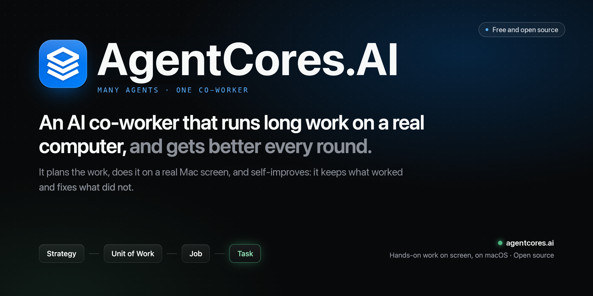
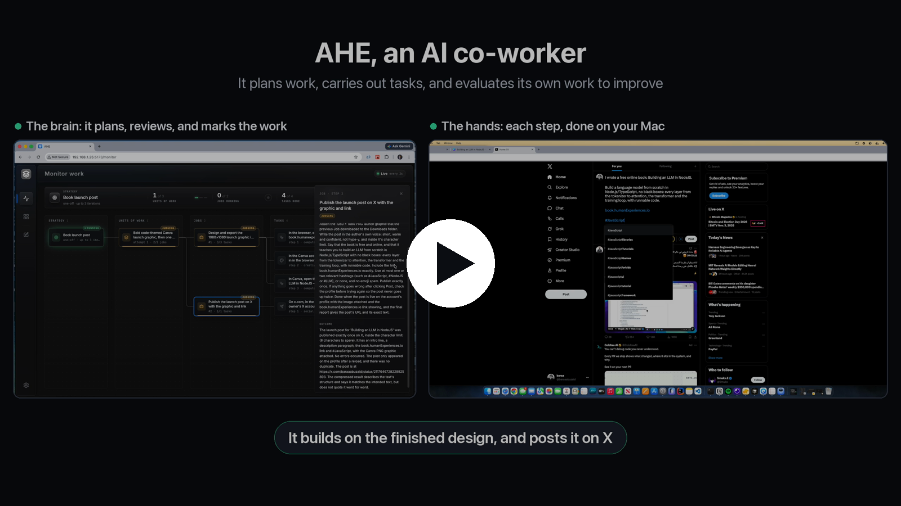
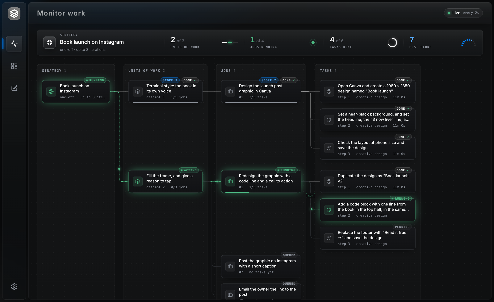
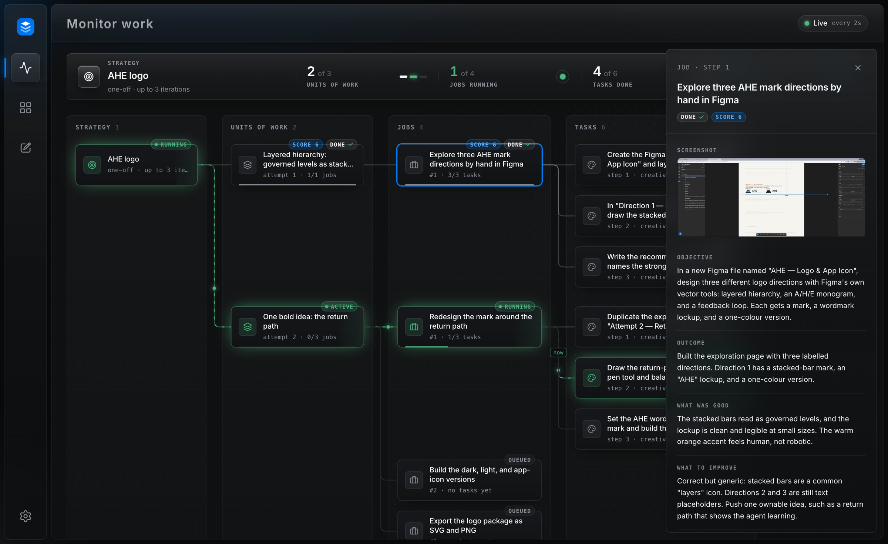
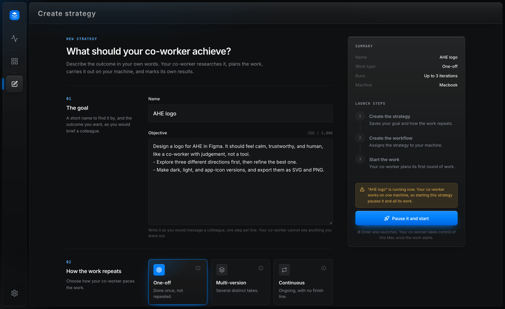
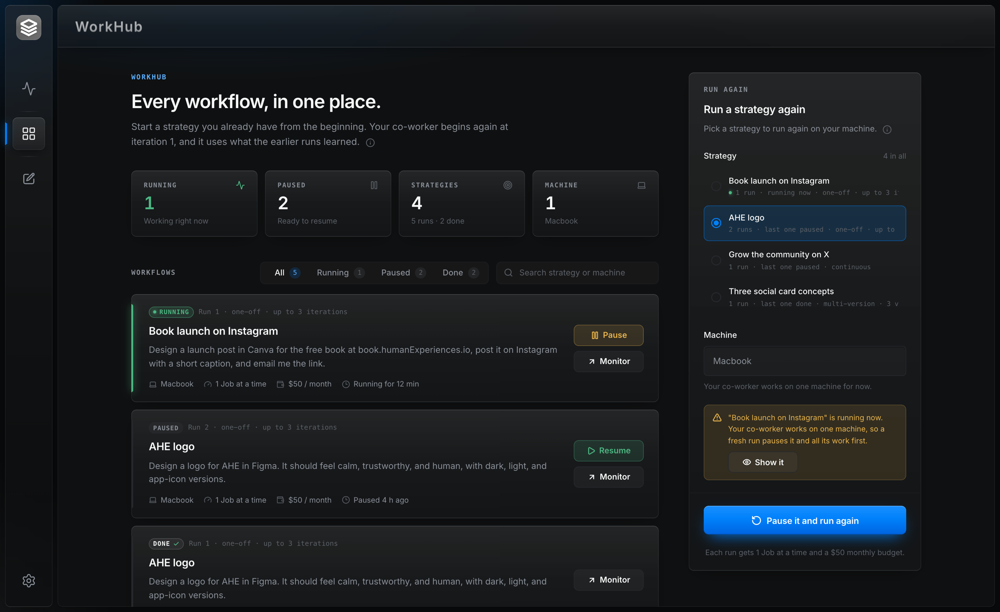

<p align="center">
  <a href="https://agentcores.ai">
    
  </a>
</p>

<h3 align="center">Give it a goal. It plans, acts on a real Mac, and self-improves with every round.</h3>

<p align="center">
  <a href="https://www.npmjs.com/package/agentcores"></a>
  
  
  <a href="https://github.com/BaraaSoft/agentcores/blob/main/LICENSE"></a>
</p>

<p align="center">
  <b><a href="https://agentcores.ai">Website</a></b> ·
  <b><a href="https://github.com/BaraaSoft/agentcores#demo">Watch the demo</a></b> ·
  <b><a href="https://github.com/BaraaSoft/agentcores">GitHub</a></b> ·
  <b><a href="https://github.com/BaraaSoft/agentcores/issues">Report a bug</a></b>
</p>

---

## Start in 60 seconds

```bash
npx agentcores init   # check Docker and the permissions, set up the database, add your API key
npx agentcores up     # start it in the background, and open the dashboard
```

That is all. The dashboard opens at [http://localhost:3088](http://localhost:3088). Write your goal, and click
**Launch**. To stop it, run `npx agentcores down`. Your data stays.

You need a Mac with Apple silicon, [Docker Desktop](https://www.docker.com/products/docker-desktop),
[Node.js 22](https://nodejs.org) or newer, and an Anthropic API key. A Meta API key for Muse also works.

## What AgentCores.AI is

AgentCores.AI is an **AI co-worker**. It takes ownership of a goal, and it carries the work for days or weeks.

You do not prompt it step by step. You brief it once, like a colleague. AgentCores.AI breaks the goal into
rounds of work. It does each piece on your Mac with the real mouse and keyboard, like a person. After every
round, it reviews its own work against real evidence. Then it keeps what worked and fixes what did not.

<p align="center">
  <a href="https://github.com/BaraaSoft/agentcores#demo">
    
  </a>
  <br />
  <sub><b>Watch the demo.</b> AgentCores.AI plans a book launch, designs the graphic in Canva, reviews its own work, and posts it on X.</sub>
</p>

## A co-worker, not an assistant

An assistant waits for your next prompt. A co-worker owns a piece of the work, and its judgement grows over time.

| | A typical agent | AgentCores.AI |
| --- | --- | --- |
| Scope | One prompt, one loop | One goal that runs for days or weeks |
| Memory | The chat window | A knowledge base of every round and every lesson |
| Quality | It stops when the steps end | It reviews its own work and tries a better idea |
| Evidence | It guesses | It opens the real post, file, or design first |
| When stuck | It fails or loops | It recovers, waits, or asks you one clear question |
| Control | Kill the process | Pause, resume, or run again from a dashboard |

## What it can do

- **Your data stays on your Mac.** The database, the queue, the screenshots, and the logs live on your
  machine. AgentCores.AI has no account, no cloud, and no telemetry. You bring your own API key.
- **It works in any app on your Mac.** It uses Canva, spreadsheets, the browser, or anything else on the
  screen. It recovers on its own from popups, broken pages, rate limits, and crashes.
- **It self-improves.** An evaluator reviews each piece of work against the real output and the real numbers.
  The lessons feed the next round. A new run of the same goal reads the last three runs.
- **It runs for a long time and stays cheap.** The goal splits into four levels: Strategy, Unit of Work,
  Job, and Task. Each level reads only a short summary of the level below. The thread stays clear after
  hundreds of steps.
- **It keeps you in control.** You pause, resume, or run a goal again from the dashboard. You watch the work
  live, also from another laptop or a phone.
- **It is safe by design.** Hard walls block system settings, purchases, and account changes. It reports a
  CAPTCHA and never solves it.

## The dashboard

### Watch the work, live



The **Monitor** page draws the whole run as a live board in four lanes. The green card runs now. The bar on
top shows the rounds, the Jobs at work, the Tasks done, and the best result.

### See what it made, and what it learned



Click a card to open its details. A Job shows the final screen of its work, the outcome, and the agent's own
review: what worked, and what to fix.

### Brief it like a colleague



Write a short name and the outcome you want. Choose how the work repeats: one-off, multi-version, or
continuous. Then click **Launch**.

### Every run in one place



**WorkHub** lists every run of every goal. Pause a run, resume it, or start the goal again from round 1. The
fresh run still learns from the earlier runs.

## How it works

Each round follows the same loop:

1. **Plan.** The Strategy planner researches the brief and writes the Jobs of the round.
2. **Act.** The Task planner writes one step at a time. The hands-on agent does it on the screen.
3. **Review.** The Job reviewer checks every finished Task, and it continues, revises, or closes the Job.
4. **Reflect.** The evaluator reviews each Job, and writes what worked and what to fix.
5. **Self-improve.** The next round keeps what worked and fixes what did not. The run ends when the goal is met.

The reasoning layer plans and reviews, and it never touches the screen. The execution layer sees the screen,
and clicks and types. Each layer picks its own model.

## Commands

| Command | What it does |
| --- | --- |
| `npx agentcores init` | Checks Docker and the permissions, sets up the database, asks for your API key |
| `npx agentcores up` | Starts AgentCores.AI in the background, and opens the dashboard |
| `npx agentcores down` | Stops AgentCores.AI and its database. Your data stays |
| `npx agentcores status` | Shows what runs |
| `npx agentcores logs` | Follows the backend log |

The first time, macOS asks you to allow your terminal app in **Accessibility** and **Screen Recording**. Allow
both, quit and reopen the terminal, and run `npx agentcores init` again.

**Important:** AgentCores.AI uses the real mouse and keyboard. Do not use the Mac while a Task runs. Pause the
run from the dashboard first. The agent stops after its current step.

## Choose the models

`npx agentcores init` asks for one provider, and uses it on every layer. To mix providers, edit
`~/.agentcores/.env`, then run `npx agentcores down` and `npx agentcores up`.

| Setting | What it runs | Suggested model |
| --- | --- | --- |
| `REASONING_STRATEGY_PROVIDER` | Plans each round, and reviews the work | `claude-opus-5-5` |
| `REASONING_JOB_PROVIDER` | Plans and reviews the Tasks of each Job | `claude-opus-5-5` |
| `REASONING_TASK_PROVIDER` | Plans every step | `claude-opus-5-5` |
| `EXECUTION_PROVIDER` | Sees the screen, clicks, and types | `claude-sonnet-5-5` |

Set each provider to `anthropic` or `muse`. Each one has a matching `_MODEL_ID` setting. Leave it empty to
use the suggested model.

## Questions

<details>
<summary><b>Does it work on Windows, Linux, or an Intel Mac?</b></summary>
<br />
Not yet. AgentCores.AI drives the macOS screen, and it needs a Mac with Apple silicon today.
</details>

<details>
<summary><b>Why does it need Docker?</b></summary>
<br />
Docker runs the database and the queue on your own Mac, so <b>all your data stays local</b>. Nothing goes to
a cloud database, and you do not set anything up yourself. The containers listen on <code>127.0.0.1</code>
only, so other computers on your network cannot reach them.
</details>

<details>
<summary><b>Where is my data?</b></summary>
<br />
<b>On your Mac, and nowhere else.</b> Your goals, runs, lessons, screenshots, settings, and logs live in
<code>~/.agentcores</code> and in the local database. AgentCores.AI has no account, no cloud, and no
telemetry. The only data that leaves your Mac is what the agent sends to the model provider that you
choose, with your own API key.
</details>

<details>
<summary><b>What does it cost?</b></summary>
<br />
AgentCores.AI is free and open source. You pay your model provider for the API calls that it makes.
</details>

<details>
<summary><b>Can I use the Mac while it works?</b></summary>
<br />
No. It uses the real mouse and keyboard. Use a Mac that the agent can have, and watch it from another
laptop or a phone. <code>npx agentcores up</code> prints the address to open on a device on the same Wi-Fi.
</details>

## Troubleshooting

<details>
<summary><b>"AgentCores.AI needs Docker"</b></summary>
<br />

1. Install [Docker Desktop](https://www.docker.com/products/docker-desktop).
2. Open it, and wait until it says "Engine running".
3. Run the command again.

</details>

<details>
<summary><b>"AgentCores.AI needs Node.js 22 or newer"</b></summary>
<br />

Check your version with `node -v`. Then switch to Node 22 with the tool that you use:

- Homebrew: `brew install node@22 && brew link --overwrite --force node@22`
- nvm: `nvm install 22 && nvm alias default 22`
- fnm: `fnm install 22 && fnm default 22`
- Volta: `volta install node@22`

</details>

<details>
<summary><b>"macOS has not given your terminal control of this Mac"</b></summary>
<br />

macOS gives these permissions to the app that runs the terminal. In the Cursor or VS Code terminal, that app
is Cursor or VS Code. Otherwise it is Terminal or iTerm.

1. Open **System Settings › Privacy & Security**.
2. Turn the app on in **Accessibility** and in **Screen & System Audio Recording**.
3. Quit the app with Cmd+Q, and open it again. A new tab is not enough.
4. Run `npx agentcores init` again.

</details>

<details>
<summary><b>"A port that AgentCores.AI needs is in use"</b></summary>
<br />

AgentCores.AI uses port 3088 for the dashboard, 5434 for Postgres, and 6381 for Redis. The message shows a
command that finds the program on the port. Stop that program, then run the command again.

</details>

<details>
<summary><b>The backend stops while it starts</b></summary>
<br />

Run `npx agentcores logs` to see the reason. A missing or wrong API key is the most common one. Fix it in
`~/.agentcores/.env`, then run `npx agentcores up` again.

</details>

## Support the project

If AgentCores.AI helps you, [give it a star on GitHub](https://github.com/BaraaSoft/agentcores). Stars help
other people find it. Follow [@baraaabuzaid](https://x.com/baraaabuzaid) on X for updates.

## License

AgentCores.AI is open source under the
[GNU Affero General Public License v3.0](https://github.com/BaraaSoft/agentcores/blob/main/LICENSE).
