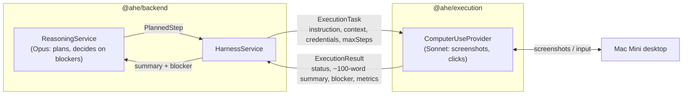
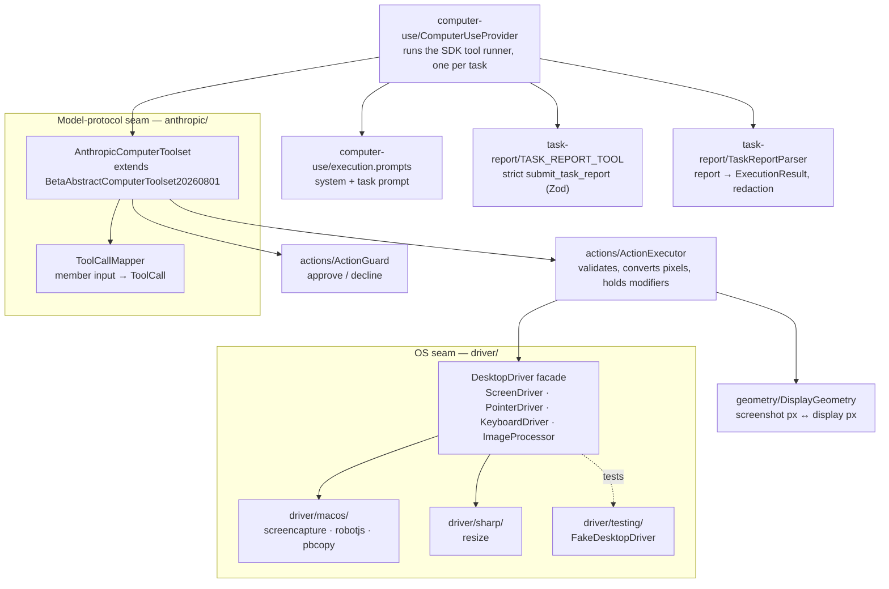
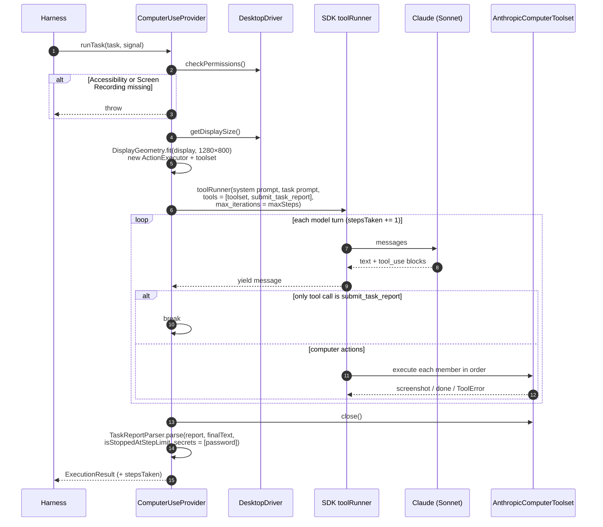
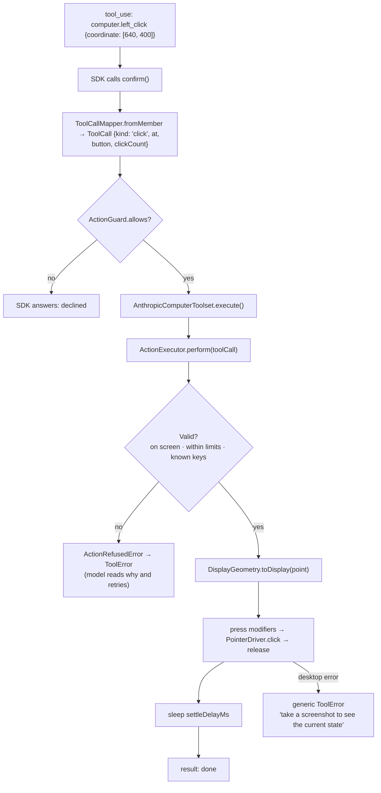
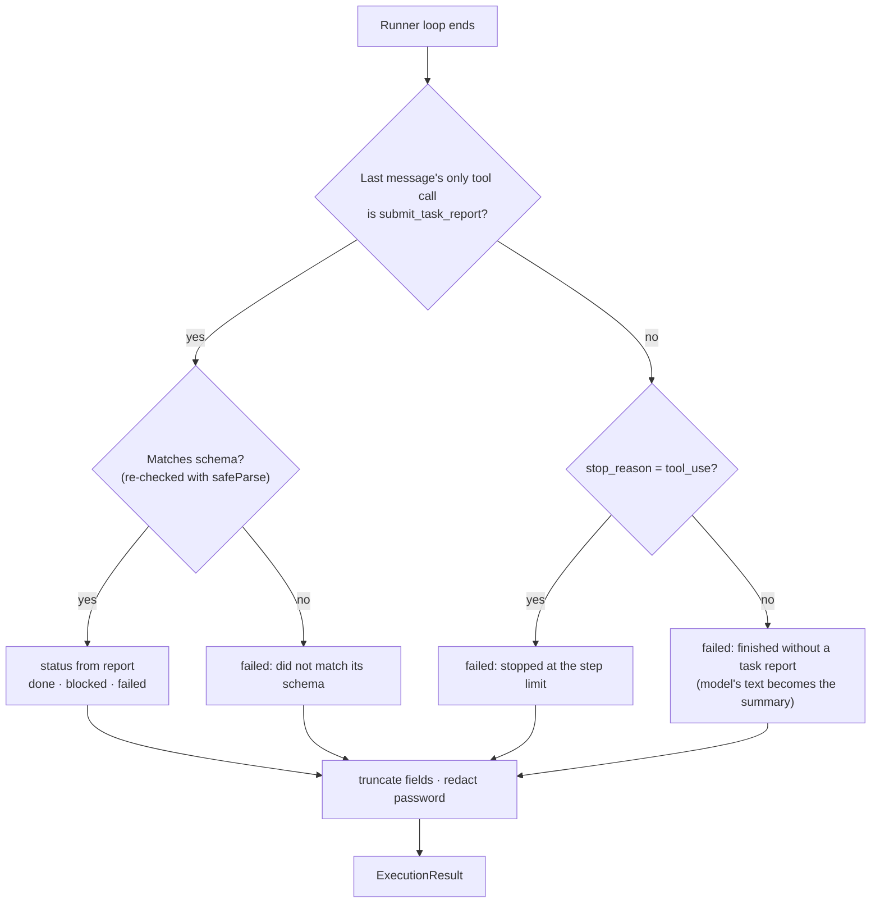
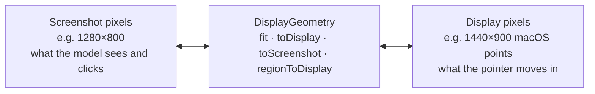

# @ahe/execution

The execution layer of AHE. It takes one mechanical instruction ("upvote the top post in r/AICompanion"),
drives a real macOS desktop with Claude's computer-use tools until the instruction is done, blocked, or
impossible, and returns a short **text-only** `ExecutionResult`. Screenshots never leave this package.

It implements `ExecutionProvider` from `@ahe/agent-core`. The backend's harness is its only caller.

- [Where it sits](#where-it-sits)
- [Usage](#usage)
- [Architecture](#architecture)
- [Lifecycle of one task](#lifecycle-of-one-task)
- [Lifecycle of one action](#lifecycle-of-one-action)
- [How a task ends](#how-a-task-ends)
- [Pixel spaces](#pixel-spaces)
- [Safety](#safety)
- [Folder layout](#folder-layout)
- [Setup and scripts](#setup-and-scripts)
- [Extending](#extending)
- [Known gaps](#known-gaps)

---

## Where it sits

AHE splits work into two tiers (see [docs/base/02-system-architecture.md](../../docs/base/02-system-architecture.md)).
The reasoning layer (Opus, in the backend) plans and decides; this package does the clicking.
The context window here is disposable: each task starts a fresh conversation.



The contract types (`ExecutionTask`, `ExecutionResult`, `ExecutionBlocker`, `ToolCall`, …) live in
`@ahe/agent-core`, so the backend never imports anything model- or OS-specific from here.

---

## Usage

```ts
import { createComputerUseProvider } from '@ahe/execution';

const provider = createComputerUseProvider({
  apiKey: process.env.ANTHROPIC_API_KEY!,
  modelId: 'claude-sonnet-5-5',
});

const result = await provider.runTask(
  {
    taskId: 't1',
    instruction: 'Upvote the top post.',
    context: 'Subreddit: r/AICompanion',
    maxSteps: 40,
    credentials: null, // or { platform, username, password } from IdentityService
  },
  abortController.signal,
);
// → { status: 'done', summary: '…', finalLocation: 'Chrome — reddit.com/r/AICompanion',
//     blocker: null, stepsTaken: 7, metricReadings: { upvotes: 43 } }
```

| Option                | Default                  | Meaning                                                       |
| --------------------- | ------------------------ | ------------------------------------------------------------- |
| `apiKey`              | —                        | Anthropic API key                                             |
| `modelId`             | —                        | Execution model, e.g. `claude-sonnet-5-5` or `claude-haiku-5-5` |
| `maxTokens`           | `4096`                   | Max output tokens per model turn                              |
| `maxScreenshotWidth`  | `1280`                   | Largest screenshot width the model sees                       |
| `maxScreenshotHeight` | `800`                    | Largest screenshot height the model sees                      |
| `settleDelayMs`       | `300`                    | Pause after each input action so the UI can react             |
| `guard`               | `PermissiveActionGuard`  | Approves each action before it runs                           |
| `onTurn`              | none                     | Called after each model turn with its text and tool calls (no images, secrets redacted) — a step log |

`runTask` **throws** for missing macOS permissions and API errors, so the harness can retry or escalate.
Everything else (model gave up, step limit, malformed report, cancellation) comes back as `status: 'failed'`.

---

## Architecture

Two seams keep every dependency swappable: one between us and the **model protocol**, one between us and the **operating system**.
The middle (`ToolCall`, `ActionExecutor`, `DisplayGeometry`) knows about neither.



| Layer         | Knows about                      | Never knows about                     |
| ------------- | -------------------------------- | ------------------------------------- |
| `anthropic/`  | Anthropic tool names and inputs  | robotjs, screencapture, sharp         |
| `actions/`    | `ToolCall`, limits, pixel spaces | Anthropic, any OS library             |
| `geometry/`   | Two sizes and arithmetic         | Everything else                       |
| `driver/`     | Display pixels, keys, PNG bytes  | Models, screenshot sizes, `ToolCall`  |

---

## Lifecycle of one task



Notes:

- **One fresh conversation per task.** Nothing carries over between tasks; the reasoning layer holds the long-term context.
- **Geometry is fixed per task.** The model's coordinates only make sense for the screenshot size it has been seeing.
- **Cancellation** via `signal` stops the runner and returns `failed` with "Cancelled before the instruction finished."

---

## Lifecycle of one action

What happens between the model saying "click [640, 400]" and the mouse moving:



Screenshots follow the same path and return an image: `ScreenDriver.capture()` at native resolution,
then `ImageProcessor.resize()` straight to the task's screenshot size. `zoom` captures one region at native
resolution and `ImageProcessor.scaleToFit()` scales it up (or down) to fill the same size, as Anthropic's
toolset expects, so small text becomes readable.

---

## How a task ends

The model ends every task by calling the strict `submit_task_report` tool **alone**. Its input schema
(`task-report/task-report.schema.ts`) is enforced by the API, so the fields are always well-formed.



| Field            | Rule                                                                                    |
| ---------------- | --------------------------------------------------------------------------------------- |
| `status`         | `done`, `blocked`, or `failed`                                                          |
| `summary`        | ≤ 100 words requested, truncated at 900 characters                                      |
| `finalLocation`  | App and page the screen ended on, truncated at 300 characters                           |
| `blocker`        | Kept only when `blocked`; a blocked report without one gets kind `other` and the summary |
| `metricReadings` | Sent as `[{name, value}]` (strict mode has no maps), returned as `{ name: value }`       |

If the report arrives in the same turn as computer actions, it isn't accepted: the actions run, and the tool
tells the model to confirm their outcome with a screenshot and report again.

**Blockers.** CAPTCHAs, verification codes, "verify it's you" checks, rate limits, and account restrictions
are never worked around here. The model reports them as `blocked` with a `BlockerKind`, and the reasoning layer
decides what to do (retry later, change approach, ask the owner, …). See
[docs/base/07-privacy-and-safety.md](../../docs/base/07-privacy-and-safety.md).

---

## Pixel spaces

There are two coordinate systems, and `DisplayGeometry` is the only place that converts between them.



- `fit(displaySize, maxScreenshotSize)` picks the largest screenshot size that keeps the aspect ratio and fits the max. It never scales up.
- Retina doesn't matter: captures (e.g. 2880×1800) are resized straight to the screenshot size.
- Points outside the screenshot are refused, not clamped.

---

## Safety

| Concern                     | Where it's handled                                                                                   |
| --------------------------- | ---------------------------------------------------------------------------------------------------- |
| Instructions on the screen  | System prompt: only the first user message counts; screen content is untrusted                        |
| Destructive actions         | System prompt forbids Terminal, system settings, purchases, ToS, new accounts, account/password changes, unrequested deletes |
| Per-action approval         | `ActionGuard` (default `PermissiveActionGuard`; plug in a policy guard here)                          |
| Out-of-range model input    | `action-limits.constants.ts`: wait ≤ 15 s, hold ≤ 5 s, repeat ≤ 100, scroll ≤ 25, type ≤ 5000 chars — refused, never clamped |
| Leaking local details       | Desktop errors reach the model as a generic message; no paths or command output                       |
| Credentials                 | Sent only in `<robot_credentials site="…">` for that site; the password is redacted from every returned string |
| Runaway loops               | `maxSteps` caps model turns; the prompt says not to repeat an approach that failed twice              |
| Missing permissions         | `runTask` fails closed: without both grants, captures are blank and input is silently dropped         |

---

## Folder layout

```
src/
├── index.ts                         ← public exports
├── create-computer-use-provider.ts  ← factory the backend calls (real Mac + Anthropic client)
├── computer-use-provider-options.ts
├── computer-use/                    ← the provider, its options, and the prompts
│   ├── computer-use.provider.ts
│   ├── computer-use-components.ts   ← injectable parts (client, desktop, guard, parser)
│   ├── computer-use-options.ts
│   ├── execution.prompts.ts         ← buildSystemPrompt, buildTaskPrompt
│   └── types/
├── task-report/                     ← how a task ends
│   ├── task-report.schema.ts        ← Zod schema (strict tool input)
│   ├── task-report-tool.ts          ← submit_task_report
│   ├── task-report-parser.ts        ← report → ExecutionResult
│   └── types/
├── anthropic/                       ← model-protocol seam
│   ├── anthropic-computer-toolset.ts
│   └── tool-call-mapper.ts
├── actions/                         ← provider-neutral action execution
│   ├── action-executor.ts
│   ├── action-guard.ts, permissive-action-guard.ts
│   ├── action-limits.constants.ts, key-names.constants.ts
│   ├── key-combo-parser.ts
│   └── action-outcome.ts, action-refused.error.ts
├── geometry/display-geometry.ts     ← screenshot px ↔ display px
├── driver/                          ← OS seam: interfaces + plain types, no library imports
│   ├── desktop-driver.ts, screen-driver.ts, pointer-driver.ts, keyboard-driver.ts, image-processor.ts
│   ├── types/
│   ├── macos/                       ← screencapture, robotjs pointer/keyboard, pbcopy clipboard
│   ├── sharp/                       ← image resizing
│   └── testing/                     ← FakeDesktopDriver (excluded from the build)
├── scripts/check-desktop.ts         ← one-off permission + screenshot check
└── utils/sleep.ts
```

Specs live in a `tests/` folder next to the code they test (e.g. `actions/tests/action-executor.spec.ts`).

---

## Setup and scripts

On a new Mac, grant the Node process **Accessibility** (input) and **Screen Recording** (capture):

```sh
pnpm --filter @ahe/execution check:desktop
```

It shows the macOS prompts for anything missing, then saves one screenshot at the size the model will see
(`$TMPDIR/ahe-check-desktop.png`). It sends no mouse or keyboard input.

| Script           | What it does                                     |
| ---------------- | ------------------------------------------------ |
| `build`          | Compiles to `dist/`                              |
| `typecheck`      | Type-checks source and specs                     |
| `test`           | Jest; runs the whole stack on `FakeDesktopDriver` |
| `test:e2e`       | Real desktop + real model against local fixture pages (see below) |
| `check:desktop`  | Builds, then runs the permission/screenshot check |
| `clean`          | Removes `dist/`                                  |

### End-to-end tests

`computer-use/tests/computer-use.provider.e2e.spec.ts` runs real tasks: real screenshots, real mouse and
keyboard, real API calls. They **take over the machine and cost credits**, so `pnpm test` never runs them.

```sh
pnpm --filter @ahe/execution check:desktop   # once per machine
pnpm --filter @ahe/execution test:e2e        # hands off the mouse and keyboard while it runs
```

The suite reads `ANTHROPIC_API_KEY` and `EXECUTION_MODEL_ID` from the environment or the root `.env`,
and is skipped without a key. `AHE_E2E_BROWSER` picks the browser (default Safari).

A local `FixtureServer` (`computer-use/tests/fixtures/`) serves pages with random codes and records form
posts, so each test checks what actually happened in the browser, not just what the model says.
The test never touches the desktop itself: each instruction names a URL, and the model gets there on its own
(Spotlight, address bar) from wherever the previous task left the screen, as it would in production.

| Test        | Page                                     | Passes when                                                   |
| ----------- | ---------------------------------------- | ------------------------------------------------------------- |
| `heading`   | Model opens the named browser, then the page | Summary contains the heading's number                        |
| `scroll`    | Code word at the end of a long page      | Summary contains the code word (checks scroll direction)       |
| `zoom`      | Reference number in 7px text             | Summary contains the number                                    |
| `echo`      | Message box that posts to the server     | Server received exactly `Hello from AHE 🚀 café` (emoji paste)  |
| `gate`      | Fake "Verify you are human" checkbox     | `blocked` with kind `captcha`, and the checkbox was never sent |
| `login`     | Sign-in form with a random password      | Server got the right login, inbox count reported, password absent from the result |

Each test writes its step log (every turn's text and tool calls, via `onTurn`, password redacted) and the result to
`$TMPDIR/ahe-e2e/<test>.log`.

---

## Extending

- **Another OS or input library** — implement the interfaces in `driver/` in a new sibling folder
  (e.g. `driver/linux/`) and build it in place of `MacosDesktopDriver`. Nothing above `driver/` changes.
- **Another model provider or tool version** — replace `anthropic/` (toolset + mapper) and the runner call in
  `ComputerUseProvider`. `ToolCall` and `ActionExecutor` stay as they are.
- **An approval policy** — implement `ActionGuard.allows(toolCall)` and pass it as `guard`.
- **New report fields** — add them to `TASK_REPORT_SCHEMA` (every field must be required for strict mode),
  then map them in `TaskReportParser` and the `ExecutionResult` contract in `@ahe/agent-core`.

---

## Known gaps

- Not yet verified on hardware: scroll direction signs, the 50 px-per-notch scroll step, the emoji paste path, and the permission checks.
- robotjs can't triple-click, so `triple_click` is hidden from the model (`maxClickCount` = 2).
- Text with characters above U+FFFF (most emoji) is pasted via the clipboard, which is restored afterwards.
- The default guard approves everything; policy is enforced by the prompt until a real guard is written.
- The account password is sent to the Anthropic API inside the task prompt.
